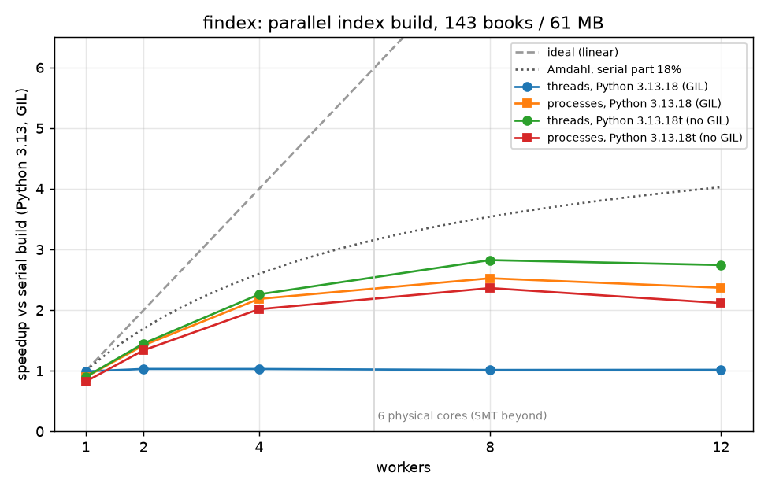

# findex

[](https://github.com/erwrqq2/Python/actions/workflows/ci.yml)

**Живий пошук: <https://findex-f2zl.onrender.com>** · API: <https://findex-f2zl.onrender.com/docs>
(безкоштовний тариф Render: після 15 хв без запитів перше відкриття триває ~30–60 с)

Невелика повнотекстова пошукова система, яку крок за кроком будую протягом
8 лабораторних курсу Python. Кожна лаба додає одну особливість мови й одну
частину рушія.

| Лаба | Тема | Тег |
|------|------|-----|
| 1 | Ітератори, генератори та корпус | `lab-01` |
| 2 | Інвертований індекс: словники, хешування та пам'ять | `lab-02` |
| 3 | Рейтинг і модель об'єктів: dunder-методи, протоколи, декоратори | `lab-03` |
| 4 | Типи, тести, пакування і CLI | `lab-04`, `v0.4.0` |
| 5 | Конкурентність і GIL: потоки, процеси і паралельна індексація | `lab-05` |
| 6 | Асинхронний краулер: asyncio | `lab-06` |
| 7 | Пошук у вебі: FastAPI, Pydantic і публічна адреса | `lab-07` |

## Запуск

Потрібні [uv](https://docs.astral.sh/uv/) і Python 3.13

```bash
uv sync
uv run python scripts/download_gutenberg.py --count 150   # корпус -> data/
uv run python -m findex.stats data/
uv run findex index data/ --out index.fidx --positions
uv run findex search index.fidx 'locomotive AND (steam OR engine) NOT "civil war"'
uv run findex stats index.fidx
uv run findex serve --index crawl.fidx --corpus corpus/books-toscrape.jsonl   # http://127.0.0.1:8000
uv run python -m findex.evaluate index.fidx evaluation/queries.json
uv run pytest
uv run ruff check .
uv run pyright
```

## Корпус

**Project Gutenberg**, англомовні книги у форматі plain text.

- `scripts/download_gutenberg.py` завантажує офіційний каталог
  (`pg_catalog.csv`) з дзеркала `gutenberg.pglaf.org` (Project Gutenberg просить
  автоматичні клієнти користуватися дзеркалами), відбирає англомовні записи типу
  *Text* з фіксованим seed (`--seed 42`) і завантажує `--count` книг.
- Ліцензійна шапка й підвал Gutenberg (`*** START OF ...` / `*** END OF ...`)
  вирізаються; кожна книга зберігається як `data/gutenberg/<id>.txt`, перший
  рядок — назва.
- Скрипт можна перезапускати — вже завантажені книги пропускаються; між
  запитами пауза 1 с; після 5 мережевих помилок поспіль скрипт зупиняється.
- `data/` у `.gitignore` — корпус ніколи не комітиться.

Поточний розмір: **143 книги, 61 МБ** тексту в UTF-8 

---

## Лаба 1 — Ітератори, генератори та корпус

### Структура

```
src/findex/
  corpus.py     # iter_documents(root) -> Iterator[Document]
  tokenize.py   # tokenize(text) -> Iterator[str]
  stats.py      # конвеєр + `python -m findex.stats`
tests/
  test_tokenize.py
  test_corpus.py
scripts/
  download_gutenberg.py
```

### `iter_documents(root)`

Генератор: сам виклик не робить жодного вводу-виводу, кожен `next()` відкриває
один файл, повертає `Document(doc_id, path, text)` (`NamedTuple`) і йде далі.
Джерела: дерево каталогів із `*.txt` (через `Path.rglob`) або файли `*.jsonl`
(по одному JSON-об'єкту з полем `"text"` у рядку). Некоректний UTF-8
записується в лог як попередження й декодується із символами заміни; файли,
які не вдалося прочитати, і биті JSON-рядки логуються й пропускаються — один
поганий документ ніколи не зупиняє обробку.

Список *шляхів* сортується (кілька КБ), тож `doc_id` стабільні між запусками;
самі тексти ніколи не збираються в пам'ять разом.

Демонстрація лінивості — повертається миттєво, читається лише перший файл:

```python
>>> from pathlib import Path
>>> from findex.corpus import iter_documents
>>> next(iter_documents(Path("data"))).path
WindowsPath('data/gutenberg/10072.txt')     # 0.001 с на корпусі 61 МБ
```

### `tokenize(text)` — правила

Порядок: **NFC для всього тексту → `re.finditer` → для кожного токена:
уніфікація апострофів + `casefold()`**. У лабі пропонується робити casefold
усього тексту до пошуку токенів; я роблю casefold кожного знайденого токена,
бо `casefold()` для цілого великого документа коштує ~52 МіБ тимчасового буфера
Шаблон приймає літери в будь-якому регістрі, тож
токени ті самі — перевірено на всьому корпусі: однакова кількість токенів
(10 487 819) і розмір словника (146 829) в обох варіантах.

| Правило | Приклад |
|---------|---------|
| Спершу NFC: розкладені й складені літери рівні | `cafe` + U+0301 → `café` |
| `casefold()`, а не `lower()` | `Straße` → `strasse` |
| Токен = максимальна послідовність Unicode-літер/цифр (`[^\W_]`), будь-яка писемність | `Київ` → `київ` |
| `_` — роздільник (у Gutenberg `_курсив_`) | `_italic_` → `italic` |
| Апостроф усередині слова зберігається; `’ ‘ ʼ` `` ` `` зводяться до `'` | `don't`, `П’ять` → `п'ять` |
| Апостроф на початку/в кінці слова — це лапка, відкидається | `'Tis` → `tis`, `students'` → `students` |
| Дефіс розділяє слова (кращий recall: запит "known" знайде "well-known"; у Gutenberg багато тире `--`) | `well-known` → `well`, `known` |
| Цифри — звичайні символи токена; розділові знаки всередині числа розбивають його | `1984`, `mp3`, `19th`; `3.14` → `3`, `14` |

Регулярний вираз (`A` = `(?:[^\W_][\u0300-\u036f]*)+` — послідовність
літер/цифр разом із комбінованими діакритичними знаками): `A(?:['’‘ʼ`]A)*`.

Тести: `tests/test_tokenize.py` (10 перевірок: генератор, порожній рядок і
лише пунктуація, змішаний регістр + casefold, пунктуація, кирилиця,
комбінований наголос, апострофи, апострофи-лапки, дефіси, цифри) і
`tests/test_corpus.py` (лінивість, порядок, JSON-lines, погане кодування).

Обидві функції — генератори, це перевіряється в тестах через
`inspect.isgeneratorfunction`.

### Статистика

```bash
uv run python -m findex.stats data/              # увесь корпус, лінива версія
uv run python -m findex.stats data/ --limit 50   # перші 50 документів (itertools.islice)
uv run python -m findex.stats data/ --eager      # версія на списках
```

Вивід на всьому корпусі:

```
mode:        lazy (generators)
documents:   143
tokens:      10,487,819
vocabulary:  146,829
top 50 terms:
    1. the                  667,169
    2. of                   365,524
    3. and                  325,893
    4. to                   270,761
  ...
   50. would                 24,666
elapsed:     22.76 s
peak memory: 26.3 MiB (tracemalloc)
```

Усі топ-50 — службові слова (the, of, and, to, a, in, that, he, was, i, ...) —
закон Ципфа; стоп-слова матимуть значення для ранжування в лабі 3.

### Жадна vs лінива версія

`compute_stats_eager` читає всі документи в список, токенізує кожен у список
токенів і лише потім рахує. `compute_stats` працює потоково: один документ →
токени → `Counter`. Той самий корпус, той самий токенізатор, кожен запуск в
окремому процесі (`python -m findex.stats data/ [--eager] [--limit N]`).
Windows 11, Python 3.13.18, 32 ГБ RAM; жадна версія витримує весь корпус, тому
основна таблиця — на ньому.

| Version | Documents | Peak memory | Elapsed |
|---------|-----------|-------------|---------|
| eager (lists) | 143 | 627.3 MiB | 23.22 s |
| lazy (generators) | 143 | 26.3 MiB | 22.76 s |

Як це масштабується з розміром корпусу:

| Документів | Токенів | пік eager | пік lazy | час eager | час lazy |
|-----------|--------|-----------|----------|-----------|----------|
| 25  | 2 127 932  | 125.1 МіБ | 8.9 МіБ  | 4.44 с  | 4.29 с  |
| 75  | 5 721 742  | 334.7 МіБ | 11.3 МіБ | 11.82 с | 12.07 с |
| 143 | 10 487 819 | 627.3 МіБ | 26.3 МіБ | 23.22 с | 22.76 с |

Час виміряно з увімкненим tracemalloc, який сповільнює код із великою
кількістю алокацій; обидві версії платять однакові накладні витрати.

### Куди пішла пам'ять

**Жадна версія (627 МіБ)** — окремо виміряно через tracemalloc:

- **82 МіБ — усі тексти одночасно** в `list[Document]`. 61 МБ на диску в пам'яті
  займають більше: `str` зберігає кожен символ із шириною найширшого символу
  рядка, тож один `’` чи `☆` робить усю книгу по 2 байти на символ.
- **540 МіБ — список списків токенів.** 10,5 млн токенів × ~54 байти: кожен
  токен — окремий об'єкт `str` (`sys.getsizeof("the")` = 44 байти: заголовок,
  хеш, довжина, дані) плюс 8-байтовий вказівник у списку (лише об'єкти списків —
  85 МіБ). Слово "the" трапляється 667 тис. разів і зберігається 667 тис. разів —
  список тримає кожне входження, а `Counter` — один ключ на кожен окремий терм.
- Підсумковий `Counter` (~11 МіБ) — єдина частина, яка насправді потрібна.

Пам'ять росте лінійно з розміром корпусу (125 → 335 → 627 МіБ). Час однаковий,
бо обидві версії виконують ту саму роботу; жадна просто тримає проміжні
результати. Це перестає бути безкоштовним, щойно дані не вміщаються в RAM.

**Лінива версія (26 МіБ) — чому не нуль:** пік — це «найбільший окремий
документ + `Counter`», і він не залежить від кількості документів:

- `Counter` зі 146 829 термами: 10,6 МіБ наприкінці;
- найбільший документ (*Motion pictures 1950–1959*, каталог реєстрації
  авторських прав, 4,3 млн символів, містить `☆` → 8,2 МіБ як `str`), плюс сирі
  байти (4,3 МіБ), які коротко існують під час декодування;
- кадри генераторів, один `Document`, один об'єкт збігу `re` — байти.

Пік лінивої версії зменшився з **85 МіБ до 26 МіБ** після одного виправлення.
Покрокове профілювання найбільшого документа показало: NFC безкоштовний (текст
уже в NFC, `unicodedata.normalize` повертає той самий об'єкт); `translate`
коштує одну копію (8,5 МіБ); але **`casefold()` для всього документа дав пік
59,6 МіБ** — CPython виділяє UCS-4-буфер із запасом на 3 вихідні символи на
кожен вхідний (один символ може перетворитися на три, напр. `ffi` → `ffi`):
4,3 млн × 3 × 4 Б ≈ 52 МіБ. Casefold кожного токена після пошуку прибирає і цей
сплеск, і копію всього тексту; швидкий шлях для ASCII (`str.isascii()` — O(1))
пропускає `translate` для більшості токенів, тож код ще й прискорився
(4,73 с → 4,29 с на 25 документах).

### Чого я навчився

- Генераторна функція не виконує жодного коду до першого `next()`; помилки
  з'являються там, де генератор споживається (у `Counter.update`), а не там, де
  він визначений.
- Пам'ять лінивого конвеєра обмежена *найбільшим елементом*, а не *кількістю
  елементів* — тож пік визначає один величезний документ.
- Спершу виміряй, потім вгадуй: прихована ціна була в `casefold()`, а не в
  регулярному виразі.

---

## Лаба 2 — Інвертований індекс: словники, хешування та пам'ять

### Структура

```
src/findex/
  index.py      # Posting, DocMeta, Index, build_index() + `python -m findex.index`
  search.py     # Boolean-пошук, рушії merge/set + `python -m findex.search`
  store.py      # save()/load(): pickle і власний бінарний формат
  memstudy.py   # три варіанти зберігання постингів під tracemalloc
  bench.py      # бенчмарк merge vs set
tests/
  test_index.py  test_search.py  test_store.py  test_cli.py
```

### Індекс

- `postings: dict[str, list[Posting]]` — терм → постинги, відсортовані за `doc_id`;
- `doc_lengths: dict[int, int]` — кількість токенів у документі (для BM25 у лабі 3);
- `doc_meta: dict[int, DocMeta]` — шлях і назва для показу результатів.

`Posting(doc_id, tf, positions=())` і `DocMeta(doc_id, path, title)` —
`@dataclass(frozen=True, slots=True)`: незмінні, хешовані (можна класти в `set`),
без `__dict__` в кожному екземплярі.

Індекс будується **одним проходом** по лінивому конвеєру з лаби 1: для кожного
документа токени рахуються в маленькому `Counter`, потім по одному `Posting` на
кожен терм додається в `defaultdict(list)`. Корпус у пам'ять не завантажується —
росте лише індекс. Постинги відсортовані без жодного `sort()`: `iter_documents`
видає `doc_id` 0, 1, 2, … за зростанням, а ми лише дописуємо в кінець.

Прапорець `--positions` додає до кожного постингу позиції токенів (для фразового
пошуку в лабі 3).

```bash
uv run python -m findex.index data/ --out index.bin                                # pickle
uv run python -m findex.index data/ --out index.fidx --format binary --positions   # свій формат
```

```
documents:   143
terms:       146,829
postings:    916,902
positions:   no
build:       24.49 s
save:        6.94 s (pickle)
file:        index.bin (15.1 MiB)
peak memory: 230.5 MiB (tracemalloc)
```

### Пошук

```bash
uv run python -m findex.search index.bin "telegraph OR telephone NOT war"
uv run python -m findex.search index.fidx "whale harpoon" --engine set
```

```
query:       'telegraph OR telephone NOT war' (engine=merge)
6 of 143 documents match
  [  11] Mount Music  (data\gutenberg\14025.txt)
  [  28] The Great Potlatch Riots  (data\gutenberg\24864.txt)
  ...
load:        6.081 s
search:      0.201 ms
peak memory: 230.2 MiB (tracemalloc)
```

(`load` тут повільний через tracemalloc; чисті цифри — у таблиці збереження нижче.)

Мова запитів обчислюється **строго зліва направо**, без пріоритетів і дужок
(справжній парсер — у лабі 3):

| Запит | Значення |
|-------|----------|
| `a b`, `a AND b` | документи з обома термами |
| `a OR b` | з будь-яким із них |
| `a NOT b` | з `a`, але без `b` |
| `NOT a` | усі документи без `a` |
| `a OR NOT b` | з `a` або без `b` |
| `a OR b NOT c` | `(a OR b) NOT c` |

Слова запиту проходять той самий токенізатор, що й документи (`Whale` знайде
`whale`); слово, яке розпадається на кілька токенів (`well-known`), означає AND усіх.

Два рушії з однаковим інтерфейсом (`--engine {merge,set}`):

- **merge** — два вказівники по відсортованих списках `doc_id`: `intersect`,
  `union`, `difference` за O(len(a) + len(b)), без хешування;
- **set** — `set(a) & set(b)`, `|`, `-`, а потім `sorted()`.

Тести перевіряють, що обидва рушії дають однаковий результат на всіх запитах, а
merge-операції збігаються з set-операціями на 200 випадкових парах списків.

### Збереження: pickle і власний бінарний формат

`store.save(index, path, fmt)` / `store.load(path)`; формат `load` визначає за
першими байтами файлу.

**pickle** — один виклик в кожен бік. **Ніколи не викликайте `load()` для чужого
pickle-файлу.** Розпаковування pickle — це не «читання даних»: файл є програмою
для віртуальної машини pickle, і її опкод `REDUCE` викликає будь-яку функцію, яку
можна імпортувати, з аргументами з файлу — наприклад `os.system("...")`.
Підроблений `index.bin`, завантажений з інтернету, виконає довільний код у момент
`load()`. Pickle годиться лише для власних кеш-файлів (коментар про це є і в
`store.py`).

**binary (`.fidx`)** — власний формат на `array('I')`, у ньому лише числа й
рядки, тож завантаження ніколи не виконує код:

```
b"FIDX\x01"        магічні байти + версія
uint32 LE          довжина JSON-заголовка
JSON-заголовок     {"positions": bool,
                    "docs":  [[doc_id, path, title, length], ...],
                    "terms": [[term, offset, count, n_positions], ...]}
дані               для кожного терму: doc_ids (count × uint32), tfs (count × uint32),
                   positions (n_positions × uint32, діляться по постингах за tf)
```

Зсуви в заголовку дозволяють у майбутньому читати постинги одного терму без
розбору всього файлу (stretch: mmap).

Виміри без tracemalloc, найкраще з 3; завантаження — в окремому процесі:

| Формат | Позиції | Розмір файлу | save | load |
|--------|---------|--------------|------|------|
| pickle | ні  | 15.1 МіБ | 3.07 с | 1.15 с |
| binary | ні  | 10.4 МіБ | 0.44 с | 0.57 с |
| pickle | так | 54.1 МіБ | 4.68 с | 1.59 с |
| binary | так | 50.6 МіБ | 1.90 с | 1.21 с |

- Бінарний формат на 31% менший і вантажиться вдвічі швидше: замість опису кожного
  об'єкта (клас + стан) — суцільні масиви по 4 байти на число.
- Під час `save` pickle тримає memo-словник з посиланням на кожен записаний
  об'єкт: пік збереження 230 МіБ проти 114 МіБ для бінарного формату.
- `load` тимчасово вимикає GC: завантаження створює ~1 млн об'єктів і жодного
  сміття, а кожен автоматичний прохід GC знову обходить їх усі. Це прискорило
  завантаження приблизно на 25–35% (pickle 1.47 → 1.15 с, binary 0.73 → 0.57 с).

**Ціна позицій.** Файл більшає в 3,6× (pickle) / 4,9× (binary), пік побудови й
збереження — 114 → 549 МіБ. Позицій 10,5 млн (по одній на кожен токен корпусу),
у середньому 11,4 на постинг: 11,4 × 4 Б ≈ 46 Б позицій проти 8 Б на `(doc_id, tf)`.
У пам'яті ще гірше: кортеж позицій — це об'єкт, а кожне число > 256 — окремий
`int` (28–32 Б).

**Пастка `__main__`.** Перша версія `python -m findex.index` зберігала
нечитабельний pickle: під `-m` модуль виконується як `__main__`, тож класи
записувалися як `__main__.Index` / `__main__.Posting`, і `findex.search` падав з
`Can't get attribute 'Posting'`. Тепер точка входу викликає `main()` з
імпортованого модуля `findex.index`; `tests/test_cli.py` будує індекс в одному
процесі й шукає в іншому, щоб помилка не повернулася.

### Пам'ять: три способи зберігати постинги

`uv run python -m findex.memstudy data/` — той самий корпус, той самий лінивий
потік, без позицій; кожен варіант будується під tracemalloc, зберігається через
pickle і завантажується назад.

| Postings representation | Peak memory (build) | Index file size | Load time |
|---|---|---|---|
| `list[Posting]`, plain `@dataclass` | 116.9 MiB | 20.3 MiB | 0.64 s |
| `list[Posting]`, `slots=True` | 81.9 MiB | 15.0 MiB | 1.90 s |
| `array('I')` pairs (doc_ids, tfs) | 56.5 MiB | 13.2 MiB | 0.19 s |

Скільки залишається в пам'яті після побудови: 112.7 / 77.7 / 51.0 МіБ.

**Куди пішли байти.** У корпусі 916 902 постинги і 146 829 термів.

- **Звичайний dataclass:** один екземпляр займає 96 Б (заголовок об'єкта 48 Б +
  значення атрибутів) плюс 8 Б вказівника в списку: 917 тис. × 104 Б ≈ 91 МіБ.
  У Python 3.13 атрибути зберігаються прямо в об'єкті, а справжній `__dict__`
  (ще +64 Б, виміряно) створюється лише при зверненні до `p.__dict__`. Тому
  різниця зі slots — ~40 Б, а не ~100 Б, як у старіших версіях.
- **`slots=True`:** `sys.getsizeof(Posting(...))` = 56 Б (заголовок + 3 слоти по
  8 Б), разом із вказівником — 64 Б × 917 тис. ≈ 56 МіБ. Різниця з першим рядком,
  35 МіБ, — це якраз 917 тис. × ~40 Б.
- **`array('I')`:** постинг займає лише 8 Б (4 Б `doc_id` + 4 Б `tf`, без
  об'єктів): 917 тис. × 8 Б ≈ 7 МіБ. Решта ~45 МіБ — це накладні витрати на
  терм, однакові для всіх рядків: словник на 147 тис. ключів, рядки термів
  (~50 Б кожен) і контейнери. У варіанті з масивами на кожен терм припадає кортеж
  (56 Б) і два об'єкти `array` (по 80 Б + запас). **64% термів трапляються лише в
  одному документі**, у середньому 6,2 постинги на терм, тож ці контейнери коштують
  більше, ніж самі дані.

Якщо рахувати лише постинги, `array` в 8 разів компактніший за slots (64 Б → 8 Б).
Загалом виграш лише в 1,45 раза: його з'їдають накладні витрати на терм. Числа
`doc_id ≤ 142` і більшість `tf` — малі цілі (≤ 256), CPython тримає їх у кеші,
тому в об'єктних варіантах вони нічого не коштують. На корпусі з тисячами
документів кожен `doc_id` став би окремим `int` на 28–32 Б, і різниця зросла б.

**Load time** показує інше: slots завантажується *повільніше* за звичайний
dataclass (1.90 с проти 0.64 с). Для frozen-dataclass зі slots `dataclasses`
генерує `__getstate__`/`__setstate__` на Python, який для кожного з 917 тис.
об'єктів викликає `object.__setattr__` на кожне поле. Звичайний екземпляр pickle
відновлює одним оновленням атрибутів на C. `array` серіалізується як суцільний
блок байтів, тому вантажиться найшвидше. (У цьому замірі GC під час
завантаження увімкнений.)

### Бенчмарк: merge vs set

`uv run python -m findex.bench index.bin` — найкращий із 5 повторів `timeit`,
мікросекунди на весь `evaluate()` (розбір запиту + отримання списків + операція).

| Терми (df) | Запит | merge, мкс | set, мкс | Збігів |
|---|---|---|---|---|
| 2 найчастіші: the (143), of (143) | `the of` | 17.0 | 12.9 | 143 |
| | `the OR of` | 17.1 | 12.5 | 143 |
| | `the NOT of` | 15.3 | 11.2 | 0 |
| 2 найрідкісніші: mehring (1), niebauer (1) | `mehring niebauer` | 3.9 | 4.0 | 1 |
| | `mehring OR niebauer` | 4.0 | 4.0 | 1 |
| | `mehring NOT niebauer` | 3.9 | 4.1 | 0 |
| частий + рідкісний: the (143), mehring (1) | `the mehring` | 10.8 | 7.3 | 1 |
| | `the OR mehring` | 12.6 | 8.9 | 143 |
| | `the NOT mehring` | 12.9 | 8.8 | 142 |

У корпусі зі 143 документів найдовший список постингів — 143 id, тому той самий
бенчмарк повторено на синтетичних списках (AND, випадкові id):

| Розміри списків | merge, мкс | set, мкс | set / merge |
|---|---|---|---|
| 1 000 & 1 000 | 109 | 37 | 0.34 |
| 10 000 & 10 000 | 1 171 | 760 | 0.65 |
| 100 000 & 100 000 | 13 511 | 13 107 | 0.97 |
| 1 000 000 & 1 000 000 | 137 584 | 163 257 | 1.19 |
| 1 000 000 & 10 | 92 335 | 57 343 | 0.62 |
| 1 000 000 & 1 000 | 103 754 | 63 433 | 0.61 |

**Хто де виграє і чому.** Асимптотика однакова, O(n + m), але константи різні:

- **Короткі списки — виграє set** (у 1,3–3 рази). Його цикли написані на C, а
  merge виконує байт-код Python на кожен крок. На рідкісних термах (по 1 id)
  різниці немає: час іде на розбір запиту й токенізацію.
- **Від ~100 тис. елементів — виграє merge** (1,19× на мільйоні). `set` мусить
  побудувати дві хеш-таблиці на мільйон записів (десятки МіБ, промахи кешу,
  алокації) і ще відсортувати результат. Merge лише послідовно читає два масиви.
- **Дуже різні розміри (1 000 000 & 10)** — погано обом: обидва лінійні за
  великим списком. Правильна відповідь — бінарний пошук / galloping (O(m log n)),
  ідея на майбутнє.

### Чого я навчився

- Хешованість — це контракт: `frozen=True` дає `__hash__` з полів, тож рівні
  `Posting` мають рівні хеші й поводяться як один ключ у `set`.
- `slots` економить пам'ять, але не все: у Python 3.13 звичайні екземпляри вже
  компактні, а pickle для slots-dataclass повільніший.
- Коли більшість термів трапляється один раз, пам'ять визначають накладні витрати
  на терм, а не постинги.
- pickle прив'язує дані до *імені модуля* класу — і до безпеки: це код, а не дані.

---

## Лаба 3 — Рейтинг і модель об'єктів: dunder-методи, протоколи, декоратори

### Структура

```
src/findex/
  index.py      # Index тепер клас: Mapping[str, list[Posting]]
  store.py      # + open_index() — context manager
  engines.py    # merge/set-операції з лаби 2 (колишній search.py)
  query.py      # парсер рекурсивним спуском, вузли Term/Phrase/And/Or/Not
  rank.py       # Scorer, TfIdf, BM25, SearchResult, Searcher (+ lru_cache)
  snippet.py    # сніпети ±80 символів з підсвіткою
  timing.py     # @timed
  search.py     # CLI ранжованого пошуку
  sanity.py     # три sanity-check рейтингу на корпусі
  evaluate.py   # P@5 для TF-IDF vs BM25
evaluation/queries.json   # 10 запитів із ручною розміткою
tests/  test_query.py  test_rank.py  test_snippet.py  (+ оновлені test_index, test_store, ...)
```

Індекс для лаби 3 будується з позиціями (для фраз):

```bash
uv run python -m findex.index data/ --out index.fidx --format binary --positions
```

Індекси, збережені pickle-ом у лабі 2, треба перебудувати: клас `Index` змінився, а
pickle зберігає посилання на клас, а не дані «самі по собі».

### `Index` як об'єкт Python

`Index` успадковує `collections.abc.Mapping[str, list[Posting]]` і реалізує лише
абстрактні методи — `get`, `keys`, `items`, `values` дістаються безкоштовно:

```python
>>> with open_index("index.fidx") as ix:
...     ix
...     len(ix), "locomotive" in ix, ix["locomotive"][0], ix.df("locomotive")
...     ix.num_docs, round(ix.avg_doc_length)
Index(terms=146_829, docs=143, positions)
(146829, True, Posting(doc_id=10, tf=1, positions=(47038,)), 16)
(143, 73341)
```

| Синтаксис | Метод |
|-----------|-------|
| `len(ix)` | `__len__` — кількість термів |
| `"x" in ix` | `__contains__` — пряма перевірка в dict (швидше за дефолтну з `Mapping`, яка робить `ix[x]` у try/except) |
| `ix["x"]` | `__getitem__` — постинги; `KeyError`, якщо терму немає |
| `for t in ix` | `__iter__` — терми |
| `repr(ix)` | `__repr__` — `Index(terms=146_829, docs=143, positions)` |

- `num_docs` — `@property`; `avg_doc_length` — `@functools.cached_property`:
  BM25 потрібне це число для кожного постингу, тож воно рахується один раз і
  зберігається в `__dict__` екземпляра (тому `Index` — не `slots`-клас).
- `doc_length(doc_id)`, `df(term)`.
- **Рівність — за ідентичністю.** `Mapping` порівнює вміст, але порівнювати два
  індекси по 147 тис. списків постингів ніколи не потрібно: індекс — це ресурс,
  а не значення. Тому `__eq__ = object.__eq__` і `__hash__ = object.__hash__`.

`open_index(path)` — `@contextmanager`: усе до `yield` — це `__enter__`, блок
`finally` — це `__exit__`, який виконується і при нормальному виході, і при
`return`, і при винятку. Виняток не ковтається: він виникає в точці `yield`, і
після `close()` летить далі. `close()` звільняє дані індексу. Тести перевіряють
обидва випадки.

### Мова запитів: парсер рекурсивним спуском

Граматика (від найнижчого пріоритету):

```
or_expr  := and_expr ( "OR" and_expr )*
and_expr := not_expr ( ["AND"] not_expr )*     # AND можна пропускати
not_expr := "NOT" not_expr | atom
atom     := СЛОВО | "фраза в лапках" | "(" or_expr ")"
```

Кожне правило — окремий метод `_Parser`, який викликає методи вищого пріоритету;
дужки повертають у `or_expr` — звідси й «рекурсивний спуск». Лексер (`_lex`)
спершу розбиває рядок на дужки, оператори й готові вузли `Term`/`Phrase`.

- `a OR b c` → `Or(a, And(b, c))`: AND зв'язує сильніше за OR, тому `b c`
  складається в `And` всередині правої частини OR.
- `a NOT b` → `And(a, Not(b))`; `NOT a OR b` → `Or(Not(a), b)`.
- Оператори — лише ВЕЛИКИМИ літерами; `and`/`or`/`not` — звичайні слова.
- Слова проходять токенізатор документів; слово з дефісом (`well-known`) стає
  фразою.

**Це заміна мови з лаби 2**, де запит читався строго зліва направо. Тепер
`whale OR text NOT ship` означає `whale OR (text AND NOT ship)`, а не
`(whale OR text) NOT ship`.

Вузли — `@dataclass(frozen=True)`, тому дерева порівнюються через `==` (тести
парсера порівнюють дерева, а не рядки) і є хешованими. Їх можна будувати
операторами (`__and__`, `__or__`, `__invert__`):

```python
>>> parse('python AND (async OR await) NOT java "event loop"')   # перенесено для читабельності
And(left=And(left=And(left=Term(word='python'),
                      right=Or(left=Term(word='async'), right=Term(word='await'))),
             right=Not(child=Term(word='java'))),
    right=Phrase(words=('event', 'loop')))
>>> Term("a") | Term("b") & ~Term("c") == parse("a OR b NOT c")
True
```

`node.evaluate(index, engine)` повертає булеву множину збігів будь-яким із двох
рушіїв лаби 2 (`--engine set|merge`). `And(x, Not(y))` обчислюється як `x − y`,
без побудови доповнення `y`. **Фраза** вимагає позицій: документи-кандидати —
перетин списків постингів, далі для кожного документа двовказівниковий merge:
позиція `p` першого слова лишається, якщо `p + 1` є в позиціях другого, `p + 2` —
у третього, і так далі.

### Ранжування: протокол `Scorer`, TF-IDF і BM25

```python
class Scorer(Protocol):
    def __call__(self, term: str, posting: Posting, index: Index) -> float: ...
```

`TfIdf` і `BM25` — frozen-dataclass з `__call__`; від протоколу вони **не
успадковуються** (duck typing): підходить будь-який callable з такою сигнатурою,
навіть `lambda` (перевіряється в тестах через `@runtime_checkable`).

- **TF-IDF:** `(1 + ln tf) · ln(N / df)`.
- **BM25** (варіант Lucene/Elasticsearch):
  `idf · tf·(k1+1) / (tf + k1·(1 − b + b·dl/avgdl))`, де
  `idf = ln(1 + (N − df + 0.5)/(df + 0.5))` (ніколи не від'ємний), `k1 = 1.5`,
  `b = 0.75`.
  - **k1** керує насиченням tf: зі зростанням tf бал прямує до `idf·(k1+1)`.
  - **b** керує нормалізацією за довжиною: при `b = 0` вона вимкнена, при `b = 1`
    повна.

`Searcher.search(query, scorer=BM25(), k=10)`:

1. розбирає запит у дерево;
2. отримує булеву множину збігів (кешовано, див. нижче);
3. для кожного «позитивного» терму запиту (не під `NOT`) проходить його постинги
   й додає `score[doc_id] += scorer(term, posting, index)`;
4. бере топ-k через `heapq.nlargest(k, …)` — O(n log k) замість повного
   сортування O(n log n).

`SearchResult(score, doc_id, title, snippet)` — `@dataclass(frozen=True,
order=True)`. Поля впорядковані як `(score, doc_id)`, а `title` і `snippet`
мають `compare=False`. Тому `sorted(results, reverse=True)` дає найкращі першими,
і два результати рівні, лише якщо рівні їхні бали й документ. (У завданні
порядок полів `(doc_id, score, title)`, але тоді `sorted()` сортував би за
`doc_id`.)

### Три sanity-check рейтингу

`uv run python -m findex.sanity index.fidx`

**1. Рідкісний терм вище частого.** Запит `river OR locomotive`:
df(river) = 107, df(locomotive) = 16 зі 143.

| BM25: місце | бал | документ | містить `locomotive` |
|---|---|---|---|
| 1 | 6.072 | The Life of George Stephenson… | так |
| 2 | 4.971 | The hand of Providence | так |
| … | | | так |
| 16 | 1.871 | Our War with Spain for Cuba's Freedom | так |
| 17 | 0.722 | The Americans in the Great War… | ні |
| 18 | 0.720 | With Lee in Virginia… | ні |

Усі 16 документів із `locomotive` стоять вище за будь-який документ лише з `river`
(і для TF-IDF теж). idf(river) у BM25 = 0.29, тож навіть дуже часта «river» дає
максимум 0.29 × 2.5 ≈ 0.73, а одне входження `locomotive` (idf 2.17) — більше.

**2. 20-те повторення майже нічого не додає.** Терм `locomotive`, документ
середньої довжини (73 258 токенів):

| tf | BM25 | внесок цього входження | TF-IDF | внесок цього входження |
|---|---|---|---|---|
| 1 | 2.168 | +2.168 | 2.190 | +2.190 |
| 2 | 3.096 | +0.929 | 3.708 | +1.518 |
| 3 | 3.612 | +0.516 | 4.596 | +0.888 |
| 5 | 4.167 | +0.227 | 5.715 | +0.489 |
| 10 | 4.710 | +0.067 | 7.234 | +0.231 |
| 19 | 5.020 | +0.020 | 8.639 | +0.118 |
| 20 | 5.039 | **+0.018** | 8.752 | +0.112 |

20-те входження додає в BM25 0.8% від першого, і бал уже на 93% межі
`idf·(k1+1) = 5.416`. У TF-IDF (з логарифмом) — 5%, і росте він без межі.

**3. Короткий документ з одним входженням вище дуже довгого.** Слово
`illustration`, по одному входженню:

| документ | довжина, токенів | tf | BM25 | TF-IDF |
|---|---|---|---|---|
| Jonah Christmas 1917 | 1 475 | 1 | **0.661** | 0.368 |
| Motion pictures, 1950-1959 : Catalog… | 584 444 | 1 | 0.089 | 0.368 |

BM25 ставить короткий документ у 7,4 раза вище; TF-IDF довжини не бачить і дає
однаковий бал.

### Декоратори та кеш: `@timed` і `lru_cache`

`@timed` (`timing.py`, з `functools.wraps`) стоїть на `build_index`, `load`,
`save` і `Searcher.search`. Він пише в лог `findex.timing` рядок
`"<ім'я> took <мс> ms"` у блоці `finally`, тож виклики, що впали з винятком,
теж вимірюються. Без `wraps` усі обгорнуті функції в логах і трасуваннях
називалися б `wrapper` і втратили б docstring.

Булевий збіг кешується через `functools.lru_cache(maxsize=256)`:

- **Ключ — дерево запиту, а не рядок.** Вузли — frozen-dataclass, отже хешовані,
  тож `Locomotive (steam OR engine) NOT "Civil War"` і
  `locomotive AND (steam OR engine) NOT "civil war"` — один запис у кеші.
- **Кеш живе в екземплярі `Searcher`** (`self._match_cached =
  lru_cache(maxsize=256)(self._match)`). Якщо повісити `@lru_cache` на метод
  класу, ключем став би й `self`, і кеш тримав би кожен `Searcher` (разом з
  індексом) до кінця процесу.

```bash
uv run python -m findex.search index.fidx 'locomotive AND (steam OR engine) NOT "civil war"' \
    'Locomotive (steam OR engine) NOT "Civil War"' -k 3 -v
```

```
  DEBUG findex.timing: load took 1414.0 ms
  DEBUG findex.timing: Searcher._match took 0.4 ms
  DEBUG findex.rank: match cache: CacheInfo(hits=0, misses=1, maxsize=256, currsize=1)
  DEBUG findex.timing: Searcher.search took 28.1 ms
  DEBUG findex.timing: Searcher._match took 0.0 ms
  DEBUG findex.rank: match cache: CacheInfo(hits=1, misses=1, maxsize=256, currsize=1)
  DEBUG findex.timing: Searcher.search took 28.2 ms
Index(terms=146_829, docs=143, positions) loaded in 1.41 s, scorer=BM25(k1=1.5, b=0.75)

query:  locomotive AND (steam OR engine) NOT "civil war"
parsed: ((locomotive AND (steam OR engine)) AND NOT "civil war")
6 matching documents, top 3 (28.2 ms):
  1.   8.216  [  33] The Boy Scouts Book of Campfire Stories
           …d been well roofed with foliage. Here the travelers got their first view of a **steam** **engine**. The latter stood puffing and smoking near the village of Utica, to th…
  2.   7.734  [  59] Brooks's Readers, Third Year
           …reason mischief pasture couch bitter exclaimed sloping **steam** The old apple tree had stood in the corner of the pasture for so many ye…
  3.   6.845  [  10] A Gunner Aboard the "Yankee" From the Diary of Number Five of the Aft…
           …eck and piled them five deep, and about the same number in height, around the **steam** steering **engine** under the forward wheel-house. This was to give added protect…
```

Другий запит — інший рядок, але те саме дерево: `_match` зайняв 0.0 мс,
`hits=1`. Більшу частину з 28 мс `search` займає читання файлів для сніпетів;
сам булевий збіг — 0.4 мс.

### Сніпети

Для кожного результату — вікно ±80 символів навколо «найкращого» входження,
терми запиту підсвічені `**…**`. Найкраще входження — те, у вікні якого
найбільше *різних* термів запиту (при рівності — найперше), тому вище
`**steam** **engine**` вибрано замість одиночного `steam`. Пошук входжень — один
скомпільований regex з усіх термів із межами слова та `IGNORECASE`, тож він
працює на C по сирому тексту, без повторної токенізації книги на Python.
Вікна шукаються ковзним вікном із двома вказівниками, за O(кількість входжень).

### Оцінка: precision@5, TF-IDF vs BM25

`uv run python -m findex.evaluate index.fidx evaluation/queries.json --details`

10 запитів, для кожного вручну позначено книги, які *мають* бути в топ-5
(`evaluation/queries.json`; розмітка — за назвою та тематикою книги, зроблена до
запуску пошуку). P@5 = релевантних у топ-5 / 5. Коли релевантних книг менше
п'яти, найкраще можливе P@5 менше 1 — це стовпець `max`.

| Запит | Релевантних | max | BM25 P@5 | TF-IDF P@5 |
|---|---|---|---|---|
| `fishing trout flies` | 2 | 0.4 | 0.4 | 0.4 |
| `insane asylum` | 3 | 0.6 | 0.4 | 0.4 |
| `bees honey hive` | 1 | 0.2 | 0.2 | 0.2 |
| `maya yucatan` | 2 | 0.4 | 0.4 | 0.4 |
| `telegraph` | 1 | 0.2 | 0.2 | 0.2 |
| `locomotive railway` | 1 | 0.2 | 0.2 | 0.2 |
| `"civil war" confederate` | 2 | 0.4 | 0.4 | 0.4 |
| `jesus disciples` | 2 | 0.4 | 0.4 | 0.2 |
| `slavery slaves` | 3 | 0.6 | 0.4 | 0.2 |
| `apes monkeys` | 1 | 0.2 | 0.2 | 0.2 |
| **середнє** | | **0.36** | **0.32** | **0.28** |

Що видно з `--details`:

- **TF-IDF тягне догори найдовший документ.** *Motion pictures, 1950–1959*
  (каталог на 584 тис. токенів, де трапляється майже будь-яке слово) потрапляє в
  топ-5 TF-IDF у 6 запитах з 10 (`fishing trout flies`, `bees honey hive`,
  `telegraph`, `locomotive railway`, `apes monkeys`, `insane asylum`). У BM25 —
  лише в двох і нижче. Це саме те, що лагодить нормалізація за довжиною (b).
- **`jesus disciples`:** TF-IDF ставить на 2–4 місця богословські трактати, а
  BM25 повертає в топ-5 Weymouth New Testament (короткий том передмов).
- **`slavery slaves`:** BM25 піднімає *A Child's Anti-Slavery Book* на 1-ше місце
  (у TF-IDF — 3-тє) і додає *The American Missionary*.
- **Чого не вистачає обом:**
  - *Narrative of Venture* (`slavery slaves`) збігається, але не в топ-5: у BM25 —
    7-ме місце (5.009 проти 5.169 на 5-му), у TF-IDF — 14-те. Це коротка книга
    (10 тис. токенів при середніх 73 тис.) з кількома згадками; нормалізація
    за довжиною піднімає її на 7 місць, але не вистачає.
  - *Colony Treatment of the Insane* (`insane asylum`) зовсім не збігається: у ній
    є лише «asylums» (1 раз), а неявний AND вимагає саме «asylum». Без стемінгу
    (asylum/asylums, slave/slaves) це різні слова.
  - Насичення tf у BM25 має і зворотний бік: у книзі про телеграф слово
    `telegraph` трапляється 261 раз, але це майже не відрізняється від 2–3
    входжень.

Вибірка мала й шумна (10 запитів, 1–3 релевантні книги на запит), але напрям
однозначний: BM25 ≥ TF-IDF у кожному запиті, середнє 0.32 проти 0.28 із
максимально можливих 0.36.

### Чого я навчився

- Синтаксис Python (`len`, `in`, `[]`, `for`, `with`, `&`, `|`, `~`) — це
  виклики dunder-методів. Реалізувавши кілька з них, отримуєш об'єкт, що
  поводиться як вбудований, а `Mapping` додає решту.
- Протокол важливіший за ієрархію: скорер — це просто callable.
- Хешованість знову знадобилася: frozen-дерево запиту — готовий ключ для
  `lru_cache`.
- Метрика на реальних даних показала те, що в теорії виглядає дрібницею:
  без нормалізації за довжиною один гігантський документ засмічує видачу.

---

## Лаба 4 — Типи, тести, пакування і CLI

Тепер findex — пакет, що ставиться однією командою, з командою `findex`,
перевіркою типів pyright у режимі strict, тестами з Hypothesis і CI.

### Встановлення

```bash
uv tool install .                       # з клону репозиторію: findex з'являється в PATH
uv tool install https://github.com/erwrqq2/Python/releases/download/v0.4.0/findex-0.4.0-py3-none-any.whl
uvx --from dist/findex-0.4.0-py3-none-any.whl findex --help   # без встановлення
```

`[project.scripts] findex = "findex.cli:app"` — при встановленні wheel створюється
виконуваний файл `findex` (на Windows `findex.exe`) у теці `bin`/`Scripts`
оточення; він імпортує `findex.cli` і викликає `app()`. Перевірено: wheel з
`uv build` ставиться в ізольоване оточення (`uv tool run --isolated --from …whl`)
і `findex --help` працює з будь-якої теки, без репозиторію.

### CLI: `findex index | search | stats`

typer — команди й опції з анотацій типів; rich — таблиці, підсвітка, смуга
прогресу.

```bash
findex index data/ --out index.fidx --positions        # смуга прогресу rich (stderr)
findex search index.fidx 'locomotive AND (steam OR engine) NOT "civil war"' -k 3
findex search index.fidx telegraph --json | jq .title  # JSON lines у stdout
findex stats index.fidx --top 5                        # або: findex stats data/
findex -vv search ...                                  # -v = INFO, -vv = DEBUG
```

```
locomotive AND (steam OR engine) NOT "civil war"  (6 of 143 match, bm25)
┌───┬───────┬───────────────────────────────────────────────────────────────────────────┐
│ # │ score │ document                                                                  │
├───┼───────┼───────────────────────────────────────────────────────────────────────────┤
│ 1 │ 8.216 │ The Boy Scouts Book of Campfire Stories [33]                              │
│   │       │ …d been well roofed with foliage. Here the travelers got their first view │
│   │       │ of a steam engine. The latter stood puffing and smoking near the village… │
│ 2 │ 7.734 │ Brooks's Readers, Third Year [59]                                         │
│   │       │ …reason mischief pasture couch bitter exclaimed sloping steam The old     │
│   │       │ apple tree had stood in the corner of the pasture for so many ye…         │
└───┴───────┴───────────────────────────────────────────────────────────────────────────┘
```

(у терміналі терми запиту в сніпетах підсвічені жовтим)

```
$ findex search index.fidx telegraph -k 2 --json --no-snippets
{"rank": 1, "score": 3.0913, "doc_id": 102, "title": "The American Electro Magnetic Telegraph …", "path": "data\\gutenberg\\61533.txt", "snippet": ""}
{"rank": 2, "score": 2.7413, "doc_id": 120, "title": "Military Reminiscences of the Civil War, Volume 2 …", "path": "data\\gutenberg\\6962.txt", "snippet": ""}
```

- **stdout — лише дані** (таблиця або JSON lines); **stderr — уся діагностика**:
  логи, смуга прогресу, помилки. Тому `--json` можна перенаправляти в `jq` чи
  файл, навіть з `-vv`.
- **Очікувані помилки** — один рядок і код виходу 1, без стека викликів:

  ```
  $ findex search index.fidx 'whale AND'
  error: bad query: query ends where a term was expected
  $ findex search nope.fidx whale
  error: file not found: nope.fidx
  ```

  Обробляються: немає файлу, зламаний запит, фраза на індексі без позицій, файл —
  не індекс (`store.IndexFormatError`). Неочікувані винятки (баги) **не**
  ховаються: їх видно з повним стеком.
- `findex --version`, автодоповнення в shell (`--install-completion`) — від typer.
- Старі команди з README лаб 1–3 (`python -m findex.index`, `python -m findex.search`)
  працюють; `python -m findex.search` тепер просто викликає `findex search`.

### Logging замість print

Кожен модуль бере `log = logging.getLogger(__name__)`, а налаштовується логер
**один раз** — у колбеку typer-застосунку (`cli.py`, `RichHandler` у stderr).
Бібліотечний код логування не налаштовує ніколи. Формат — лінивий `%`:
`log.debug("%s took %.1f ms", name, ms)` форматує рядок, лише якщо рівень DEBUG
увімкнено (f-рядок форматувався б завжди). Діагностичні `print` у скрипті
завантаження корпусу та в `memstudy` замінено на logging; `print` лишився лише
там, де друкуються самі результати (таблиці бенчмарків).

### Типи: pyright strict

`[tool.pyright] typeCheckingMode = "strict"` для `src`, `tests` і `scripts`:
**0 помилок.**

- **`Scorer` — `typing.Protocol`**: `TfIdf`, `BM25` і навіть звичайна функція з
  потрібною сигнатурою підходять без наслідування — pyright перевіряє структуру
  (тест присвоює функцію змінній типу `Scorer`).
- **`Literal` замість рядків:** `EngineName = Literal["merge", "set"]`,
  `ScorerName = Literal["bm25", "tfidf"]`, `Format = Literal["pickle", "binary"]`.
  `save(index, path, "yaml")` — помилка ще до запуску. (typer хоче `Enum`, тож у
  CLI є `StrEnum` і словник-перехідник `Enum → Literal`.)
- **Дженерики PEP 695:** `Engine[C]` параметризований типом колекції —
  `MERGE: Engine[Sequence[int]]`, `SET: Engine[set[int]]`, а `Node.evaluate[C](…,
  engine: Engine[C]) -> C`. Раніше там був `Any`; тепер pyright знає, що merge
  працює зі списками, а set — з множинами. `@timed` типізований через
  `def timed[**P, R](func: Callable[P, R]) -> Callable[P, R]`, тож обгорнуті
  функції зберігають свої сигнатури.
- Генератори повертають `Iterator[...]`, приймають `Iterable[...]`; контекстні
  менеджери з `@contextmanager` — `Generator[...]` (анотація `Iterator` для них
  у нових стабах позначена як застаріла — pyright так і сказав).
- `TypedDict` для JSON: заголовок бінарного формату (`BinaryHeader`), рядок
  `--json` (`SearchHit`), розмічений запит (`LabelledQuery`). `Final` для констант.
- Звуження типів: `index: object = pickle.loads(...)` → `isinstance(index, Index)`.

Обхідні шляхи — усі з поясненням:

| Де | Що | Чому |
|----|----|------|
| `store.py`, `evaluate.py` | `cast(BinaryHeader, json.loads(...))` | `json.loads` повертає `Any`; формат файлу задокументований і пишеться нашим же кодом |
| `tests/test_index.py` | `# type: ignore[misc]` | тест навмисно присвоює полю frozen-dataclass, щоб перевірити `FrozenInstanceError` |
| `tests/test_store.py` | `# pyright: ignore[reportArgumentType]` | тест навмисно передає `"yaml"`, щоб перевірити перевірку під час виконання |

### Тести

`uv run pytest` — **138 тестів** (у `tests/`, спільний маленький корпус із 4
документів — у `conftest.py`):

- токенізатор (`parametrize`, включно з кирилицею, комбінованим наголосом і
  апострофами), корпус, збірка індексу, merge vs set, парсер (порівняння дерев),
  обидва скорери з трьома перевірками лаби 3, save/load, сніпети, статистика й
  P@5;
- **CLI через `typer.testing.CliRunner`**: таблиця, `--json` (кожен рядок stdout
  парситься як JSON, логи `-vv` — лише в stderr), усі очікувані помилки —
  код 1, рівно один рядок у stderr, без `Traceback`;
- `@pytest.mark.slow` — два наскрізні тести, що будують індекс в одному процесі
  й шукають в іншому (регресія пастки `__main__` з лаби 2), ~1 с кожен.
  Швидкий прогін: `uv run pytest -m "not slow"`; CI запускає всі.

**Hypothesis — 6 властивостей** (`tests/test_properties.py`), кожна — твердження
для *будь-якого* входу:

1. `load(save(index))` дає той самий індекс — для обох форматів, з позиціями й без;
2. постинги завжди відсортовані й унікальні, сума tf документа = його довжині,
   позиції відсортовані і їх рівно tf;
3. merge-операції збігаються з операціями над `set` (оракул);
4. `parse(str(tree)) == tree` для випадкових дерев запитів;
5. токенізатор не видає порожніх токенів і **ідемпотентний**: токенізація
   склеєних токенів дає ті самі токени;
6. BM25 не спадає з ростом tf і не зростає з ростом довжини документа.

**Hypothesis знайшов справжній баг.** Властивість 5 упала на вході з одного
символу U+02BC (MODIFIER LETTER APOSTROPHE) і стиснула контрприклад до нього.
За Unicode це *літера* (категорія Lm), тож `\w` її захоплював: виходив токен
`'` з одного апострофа, а з `ʼtis` — `'tis` з апострофом на початку, що порушує
власне правило токенізатора з лаби 1. Виправлено: U+02BC виключено з класу
«літера/цифра» (усередині слова він і далі працює як апостроф), додано
регресійний тест. Після виправлення властивість пройшла 20 000 прикладів.
На англійському корпусі цифри не змінилися (10 487 819 токенів, 146 829 термів).

### Покриття

`uv run pytest --cov` — **75%** (з гілками):

| Модуль | Покриття | |
|--------|----------|---|
| `cli.py` | 98% | |
| `store.py` | 98% | |
| `query.py`, `snippet.py` | 97% | |
| `rank.py`, `stats.py` | 95% | |
| `corpus.py` | 94% | |
| `index.py` | 77% | не покрито: `main()` для `python -m findex.index` |
| `evaluate.py` | 67% | не покрито: `main()`; сама логіка P@5 покрита |
| `tokenize.py`, `engines.py`, `timing.py`, `__init__.py` | 100% | |
| `bench.py`, `memstudy.py`, `sanity.py` | 0% | навмисно |
| `__main__.py`, `search.py` | 0% | навмисно |

Що навмисно лишилось поза покриттям і чому:

- **`bench.py`, `memstudy.py`, `sanity.py`** — скрипти вимірювань для README
  лаб 2–3: вони друкують таблиці з реальними числами на повному корпусі, а
  перевіряти їм нічого (вимірювані функції — merge, scorer-и, збірка індексу —
  покриті тестами).
- **`main()` у `index.py` / `evaluate.py`, `__main__.py`, `search.py`** — тонкі
  точки входу `python -m …`. `python -m findex.index` і `python -m findex search`
  виконуються в slow-тестах, але в окремому процесі, а coverage міряє лише
  поточний процес.

### CI

`.github/workflows/ci.yml` — на кожен push і pull request, на Ubuntu та
Windows: `uv sync --locked` → `ruff check` → `ruff format --check` → `pyright` →
`pytest --cov` (усі тести, разом зі slow) → `uv build` → встановлення
зібраного wheel у чисте оточення й `findex --help`. Wheel з Ubuntu
зберігається як артефакт. `uv.lock` закомічений, тож CI ставить рівно ті самі
версії залежностей.

### Реліз

Тег `v0.4.0` (версія в `pyproject.toml` — `0.4.0`), wheel
`findex-0.4.0-py3-none-any.whl` прикріплений до GitHub Release v0.4.0.

### Чого я навчився

- Анотації нічого не роблять під час виконання — їх читають pyright, typer
  (будує з них CLI) і `dataclasses`. Strict-режим знаходить не лише помилки, а й
  місця, де тип був «будь-який»: `Engine` з `Any` став дженериком.
- Властивість сильніша за приклад: 10 ручних тестів токенізатора не знайшли U+02BC,
  а Hypothesis знайшов і стиснув контрприклад до одного символу.
- Розділення stdout/stderr — це контракт CLI: без нього `--json | jq` ламається
  від першого рядка логу.

---

## Лаба 5 — Конкурентність і GIL: потоки, процеси і паралельна індексація

**Пояснення своїми словами — окрема сторінка [docs/gil.md](docs/gil.md)**: чому
потоки під GIL не прискорили індексацію, чому процеси прискорили і чим це
оплачено, де видно закон Амдала, що змінилось на 3.13t.

### build_partial + merge

`findex/parallel.py` ділить збірку індексу на дві частини:

- `build_partial(chunk, positions)` — функція рівня модуля (її можна віддати
  процесу). У воркер іде `Chunk(first_doc_id, paths)` — **шляхи до файлів**, а не
  прочитані документи: воркер читає їх сам. `doc_id` унікальні на весь корпус,
  бо кожен шматок наперед отримує свій діапазон (`first_doc_id` = позиція його
  першого файлу). Повертає `PartialIndex` з постингами у вигляді плоских
  `array('I')` — кілька великих буферів pickle-ються набагато дешевше, ніж мільйон
  об'єктів `Posting`.
- `merge(partials)` — у батьківському процесі. Шматки — суцільні діапазони
  `doc_id`, тож склеювання постингів кожного терму в порядку шматків лишає їх
  відсортованими без жодного `sort()`.
- Шматки нарізаються за **розміром у байтах**, а не за кількістю файлів (у корпусі
  є книга на 4.3 МБ — вона не повинна потрапити в шматок разом із тридцятьма
  іншими); шматків у 4 рази більше, ніж воркерів, щоб повільний шматок не
  простоював решту.
- Послідовний варіант — рівно `merge([build_partial(усі шляхи)])`; тест
  перевіряє, що він дає той самий індекс, що `build_index` з лаби 4. Окремі тести:
  будь-яке розбиття на шматки (і Hypothesis-властивість на випадкових корпусах)
  дає той самий індекс; файли індексу з `serial`, `threads` і `processes`
  **побайтно однакові**.

```bash
findex index data/ --out index.fidx --executor processes --workers 8   # типово: processes, усі ядра
findex index data/ --out index.fidx --executor threads --workers 4
findex index data/ --out index.fidx --executor serial
```

- `processes` — `ProcessPoolExecutor` з методом **`spawn`** (новий інтерпретатор на
  воркер; однаково на Windows, macOS і Linux). Безпечно для spawn: кожен воркер
  заново імпортує головний модуль, тому `findex/__main__.py` запускає CLI лише під
  `if __name__ == "__main__"`.
- Якщо воркер падає, збірка падає з **його стеком** (`concurrent.futures` додає
  трасування воркера як `__cause__`), решта шматків скасовується
  (`shutdown(cancel_futures=True)`) — нічого не зависає. Тест видаляє файл
  після нарізки й перевіряє, що `FileNotFoundError` з `build_partial` у трасуванні
  доходить до батьківського процесу.
- Воркерів не більше, ніж шматків: на маленькому корпусі не запускаються зайві
  процеси.

### Методика вимірювань

- **Машина**: AMD Ryzen 5 7500F, 6 фізичних ядер / 12 логічних
  (`os.cpu_count()` = 12), 32 ГБ RAM, Windows 11, настільний ПК (без батареї),
  під час вимірів фонові програми не навантажували процесор.
- **Корпус**: 143 книги, 61 МБ; індекс без позицій.
- **Python**: 3.13.18 (зі звичайним GIL) і 3.13.18 free-threaded (`3.13t`,
  `sys._is_gil_enabled() == False` — записано в кожному рядку результатів).
- `uv run python -m findex.bench_parallel sweep data/ --runs 3` — **кожен замір в
  окремому свіжому процесі** (пік RSS — це максимум за все життя процесу); один
  прогрівальний прогін (корпус потрапляє в кеш ОС); конфігурації чергуються
  прогін за прогоном, щоб дрейф температури й частоти розподілився на всі.
  3 прогони на клітинку, у таблиці — **медіана** і діапазон min–max.
- **Wall** — `time.perf_counter()` навколо всієї збірки (map + merge), без
  збереження файлу. **CPU** — CPU батьківського процесу (усіх його потоків) +
  CPU процесів-воркерів, прочитаний через `psutil`, поки вони ще живі (разом з
  їхнім запуском і pickle). **Peak RSS** — пік робочого набору батьківського
  процесу (Windows `peak_wset`); окремою колонкою — сума піків воркерів.
  **Speedup** — serial wall / wall на тому самому інтерпретаторі; остання колонка
  — відносно serial зі звичайним GIL.

### Результати

| Python | Executor | Workers | Wall, s (median) | min–max | CPU, s | Peak RSS parent | Workers' RSS (sum) | Merge, s | Speedup | vs GIL serial |
|---|---|---|---|---|---|---|---|---|---|---|
| 3.13.18 | serial | 1 | **7.27** | 7.22–7.50 | 7.1 | 139 MiB | — | 0.40 | **1.00×** | 1.00× |
| 3.13.18 | threads | 1 | **7.34** | 7.31–7.42 | 7.1 | 159 MiB | — | 0.51 | **0.99×** | 0.99× |
| 3.13.18 | threads | 2 | **7.06** | 6.99–7.11 | 7.0 | 171 MiB | — | 0.59 | **1.03×** | 1.03× |
| 3.13.18 | threads | 4 | **7.06** | 7.02–7.07 | 7.0 | 194 MiB | — | 0.67 | **1.03×** | 1.03× |
| 3.13.18 | threads | 8 | **7.17** | 7.13–7.27 | 7.2 | 212 MiB | — | 0.74 | **1.01×** | 1.01× |
| 3.13.18 | threads | 12 | **7.15** | 7.14–7.27 | 7.2 | 228 MiB | — | 0.78 | **1.02×** | 1.02× |
| 3.13.18 | processes | 1 | **8.09** | 8.04–8.15 | 8.0 | 169 MiB | 82 MiB | 0.53 | **0.90×** | 0.90× |
| 3.13.18 | processes | 2 | **5.12** | 5.01–5.45 | 8.8 | 179 MiB | 103 MiB | 0.65 | **1.42×** | 1.42× |
| 3.13.18 | processes | 4 | **3.32** | 3.29–3.76 | 10.7 | 203 MiB | 178 MiB | 0.67 | **2.19×** | 2.19× |
| 3.13.18 | processes | 8 | **2.88** | 2.84–2.92 | 15.2 | 226 MiB | 296 MiB | 0.79 | **2.53×** | 2.53× |
| 3.13.18 | processes | 12 | **3.07** | 3.00–3.07 | 18.5 | 244 MiB | 410 MiB | 0.81 | **2.37×** | 2.37× |
| 3.13.18t | serial | 1 | **7.91** | 7.85–8.12 | 7.6 | 146 MiB | — | 0.45 | **1.00×** | 0.92× |
| 3.13.18t | threads | 1 | **8.06** | 8.00–8.49 | 7.9 | 170 MiB | — | 0.53 | **0.98×** | 0.90× |
| 3.13.18t | threads | 2 | **5.01** | 5.00–5.09 | 8.6 | 183 MiB | — | 0.60 | **1.58×** | 1.45× |
| 3.13.18t | threads | 4 | **3.21** | 3.11–3.28 | 9.6 | 209 MiB | — | 0.71 | **2.46×** | 2.26× |
| 3.13.18t | threads | 8 | **2.57** | 2.55–2.65 | 12.4 | 238 MiB | — | 0.82 | **3.08×** | 2.83× |
| 3.13.18t | threads | 12 | **2.65** | 2.64–2.67 | 14.1 | 277 MiB | — | 0.89 | **2.99×** | 2.74× |
| 3.13.18t | processes | 1 | **8.82** | 8.81–8.83 | 8.6 | 180 MiB | 106 MiB | 0.55 | **0.90×** | 0.82× |
| 3.13.18t | processes | 2 | **5.43** | 5.38–5.52 | 9.5 | 192 MiB | 127 MiB | 0.60 | **1.46×** | 1.34× |
| 3.13.18t | processes | 4 | **3.60** | 3.59–3.63 | 11.7 | 216 MiB | 205 MiB | 0.69 | **2.20×** | 2.02× |
| 3.13.18t | processes | 8 | **3.07** | 3.06–3.15 | 16.3 | 242 MiB | 343 MiB | 0.79 | **2.57×** | 2.36× |
| 3.13.18t | processes | 12 | **3.43** | 3.40–3.45 | 20.6 | 262 MiB | 493 MiB | 0.88 | **2.30×** | 2.12× |



- **threads під GIL — 1.0× за будь-якої кількості воркерів**: CPU time = wall time,
  у кожен момент байт-код виконує один потік.
- **processes — 2.53× на 8 воркерах** (2.88 с замість 7.27 с), але CPU time
  подвоюється (7.1 → 15.2 с), а пам'ять — батько 226 МіБ + воркери 296 МіБ.
- **12 воркерів повільніші за 8**: фізичних ядер 6, далі — SMT (два потоки на
  ядро); окремий дослід: чистий цикл Python займає 0.42 с поодинці і 0.68 с, коли
  їх 12 одночасно.
- **Амдал**: на 8 процесах merge (0.79 с) + запуск пулу (0.55 с) — майже половина
  wall time. Відносно послідовної збірки це ~18% послідовної роботи → стеля ~5.4×
  навіть на нескінченній кількості ядер (пунктирна крива на графіку).
- **3.13t: потоки — 2.83×, найкращий результат** — без запуску процесів і без
  pickle; але один потік на 9% повільніший (7.91 проти 7.27 с).

**Типовий `--executor` — `processes`**: на звичайному CPython (з GIL) він виграє
(2.53× проти 1.0× у потоків).

### Гонки на 3.13t

У самій індексації спільного змінного стану немає (кожен `build_partial` пише у
свої словники), тож і гонки немає: на 3.13t індекс із 12 потоків побайтно
збігається з послідовним (перевірено окремо, у трьох прогонах; тести в CI
запускаються на звичайному 3.13). Що було б зі спільним станом,
показує `scripts/race_demo.py` (8 потоків × 200 000 оновлень, очікується
1 600 000):

| варіант | 3.13 (GIL) | 3.13t (без GIL) |
|---|---|---|
| `counter += 1` (глобальний int) | 1 600 000 | **251 297** (−84%) |
| `counts[w] += 1` (спільний Counter) | 1 600 000 | **1 093 037** (−32%) |
| те саме під `threading.Lock` | 1 600 000, 0.20 с | 1 600 000, 2.38 с |
| свій Counter у кожному потоці + merge | 1 600 000, 0.22 с | 1 600 000, 0.16 с |
| `shared.append(x)` | 1 600 000 | 1 600 000 |

Причина й фікс — у [docs/gil.md](docs/gil.md#що-змінилось-на-313t-без-gil): `+=` —
це load / add / store, між якими інший потік встигає записати своє; `Lock`
лагодить, але в 15 разів повільніше, ніж просто не ділити стан.

### Як відтворити

```bash
uv sync
uv run python -m findex.bench_parallel sweep data/ --runs 3 --out bench/results.json

# free-threaded 3.13t (typer тягне pydantic-core, для якого немає колеса під 3.13t
# на Windows, тому findex ставиться без залежностей — модулю parallel вони не потрібні)
uv python install 3.13t
uv venv .venv-ft --python 3.13t
uv pip install --python .venv-ft/Scripts/python.exe --no-deps -e .
uv pip install --python .venv-ft/Scripts/python.exe psutil
.venv-ft/Scripts/python.exe -c "import sys; print(sys._is_gil_enabled())"   # False
uv run python -m findex.bench_parallel sweep data/ --runs 3 --out bench/results.json \
    --python .venv-ft/Scripts/python.exe

uv run python -m findex.bench_parallel report bench/results.json --plot docs/speedup.png --amdahl 0.18
.venv-ft/Scripts/python.exe scripts/race_demo.py
```

Сирі результати всіх 66 прогонів — `bench/results.json`, таблиця — `bench/table.md`.

### Чого я навчився

- Конкурентність ≠ паралелізм: потоки під GIL чергуються, а не працюють
  одночасно; для роботи, обмеженої процесором, потрібні окремі інтерпретатори
  (процеси) або інтерпретатор без GIL.
- Паралелізм не безкоштовний: прискорення 2.5× коштувало вдвічі більше CPU time і
  втричі більше пам'яті.
- Послідовна частина (merge, запуск пулу) визначає стелю — оптимізувати треба
  передусім її.
- Найпростіший спосіб уникнути гонок — не ділити змінний стан: кожен воркер
  рахує своє, злиття одне.

---

## Лаба 6 — Асинхронний краулер: asyncio

### Що обходимо і звідки дозвіл

**[books.toscrape.com](https://books.toscrape.com/)** — «Books to Scrape», навчальна
пісочниця, зроблена спеціально для тренування веб-скрейпінгу (від Zyte / Scrapinghub).
На головній сторінці прямо написано *«We love being scraped!»*, а `robots.txt` там
немає (HTTP 404 = жодних обмежень). Краулер усе одно читає й виконує `robots.txt`,
тримає ліміт на хост і паузу між запитами.

- **User-Agent:** `findex-crawler/0.6 (+https://github.com/erwrqq2/Python)` — чесна
  назва й адреса для зв'язку (цей репозиторій).
- **Стеля на кількість сторінок:** `--max-pages` (типово 500).
- Обходимо лише хости зі стартових URL (або явно вказані `--domain`).

```bash
findex crawl https://books.toscrape.com/ --max-pages 500        # -> data/crawl.jsonl, crawl.log
findex index data/crawl.jsonl --out crawl.fidx --positions       # індексація — вже поза циклом подій
findex search crawl.fidx '"science fiction" OR mystery' -k 4
```

Під час обходу rich показує живі лічильники (stderr): зібрано сторінок / стеля,
сторінок за секунду, запитів у польоті, глибина черги, помилки, заблоковано
`robots.txt`, час.

```
"science fiction" OR mystery  (33 of 500 match, bm25)
┌───┬────────┬──────────────────────────────────────────────────────────────────────────┐
│ # │  score │ document                                                                 │
├───┼────────┼──────────────────────────────────────────────────────────────────────────┤
│ 1 │ 11.449 │ Mesaerion: The Best Science Fiction Stories 1800-1849 | Books to Scrape… │
│ 2 │ 10.954 │ Science Fiction | Books to Scrape - Sandbox [17]                         │
│ 3 │  8.882 │ Patience | Books to Scrape - Sandbox [200]                               │
│ 4 │  8.271 │ The Bridge to Consciousness: I'm Writing the Bridge Between Science and… │
└───┴────────┴──────────────────────────────────────────────────────────────────────────┘
```

### Як це влаштовано (`src/findex/crawler/`)

| Модуль | Що робить |
|--------|-----------|
| `fetch.py` | `fetch(client, url, *, timeout=10.0) -> FetchResult` — один GET під `asyncio.timeout`; записує статус, байти, час, кількість спроб |
| `robots.py` | `RobotsCache` — `robots.txt` окремо для кожного хоста, кешується; `asyncio.Lock` на хост, тож 20 воркерів не завантажують його 20 разів |
| `urls.py` | канонізація URL; посилання, заголовок і текст сторінки через selectolax |
| `crawl.py` | `crawl(seeds, config) -> AsyncGenerator[Page]` — черга, воркери в `TaskGroup`, семафори |
| `cli.py` | `findex crawl`: JSONL у міру надходження, живі лічильники, `crawl.log` |

**Повтори** (`fetch`) — лише для **429, 5xx, таймауту й обірваного з'єднання**,
щонайбільше **3 спроби**; інші 4xx (404 тощо) і цикл редиректів не повторюються.
Пауза перед спробою n+1: `min(8, 0.5 · 2^(n−1)) + uniform(0, 1)` — експонента плюс
jitter (щоб воркери не поверталися до сервера одночасно). Якщо сервер надіслав
`Retry-After` (секунди або HTTP-дата) — чекаємо щонайменше стільки.
`asyncio.CancelledError` не перехоплюється: скасування обходу мусить його зупиняти.

**`robots.txt`:** 200 — виконуємо; 404 / інші 4xx — обмежень немає; 5xx або таймаут —
вважаємо, що весь хост заборонений (сервер і так має проблеми).

**`crawl`** — асинхронний генератор:

```
frontier: asyncio.Queue[(url, depth)]
  └── N воркерів у TaskGroup ── robots.txt? ── семафор хоста + пауза між стартами
                                             └── глобальний семафор ── fetch()
  └── results: asyncio.Queue[Page] ──> генератор віддає сторінки (yield)
```

- **Один семафор на всі запити** (`--concurrency`, включно з `robots.txt`) і **окремий
  на кожен хост** (`--per-host`), плюс **мінімальна пауза між стартами запитів** до
  того самого хоста (`--delay`, піднімається до `Crawl-delay` з `robots.txt`).
- **Канонізація:** схема й хост у нижньому регістрі, порт за замовчуванням
  прибирається, `#фрагмент` відкидається, `.`/`..` у шляху розгортаються, слеш у
  кінці шляху прибирається, параметри query сортуються. Множина `seen` поповнюється
  в момент постановки в чергу (і цільовою адресою редиректу), тож одну адресу не
  завантажуємо двічі.
- **`max_pages` — бюджет:** воркер резервує слот перед запитом і повертає його, якщо
  сторінка впала або не HTML — обхід зупиняється рівно на `max_pages` без зайвих
  запитів. Тоді воркери скасовуються, клієнт httpx закривається.
- `TaskGroup` живе в окремій задачі-«драйвері», а не навколо `yield`: `yield` усередині
  `TaskGroup` призупинив би групу в задачі споживача, і скасування, призначене
  воркерам, могло б потрапити до споживача (PEP 789). Генератор лише читає готові
  сторінки з черги.
- **Рання зупинка:** `break` з `async for` *не* закриває асинхронний генератор одразу —
  його `finally` виконався б колись потім, під час збирання сміття. Тому споживач
  загортає його в `contextlib.aclosing(...)` — і `findex crawl`, і бенчмарк роблять
  так (важливо для Ctrl+C). Тест перевіряє, що після `break` не лишається жодної задачі
  — і саме він знайшов витік: `asyncio.wait` не скасовує свої задачі, коли скасовують
  того, хто чекає, тож `frontier.join()` і `done.wait()` висіли б вічно. Виправлено
  `finally` в супервізорі.

**Вивід:** `findex crawl` пише JSONL (одна сторінка — один рядок) у міру надходження
й не тримає сторінки в пам'яті. `iter_documents` з лаби 1 читає цей файл (поле `url`
стає джерелом документа — його показує пошук, `title` — першим рядком тексту), а
`findex index` індексує його вже після обходу.

```json
{"url": "https://books.toscrape.com/", "title": "All products | Books to Scrape - Sandbox", "text": "A Light in the ... £51.77 In stock", "fetched_at": "2026-11-15T12:44:58+00:00", "status": 200, "depth": 0}
```

`crawl.log` — статус кожного URL (і кожен повтор):

```
14:44:57,973 INFO    findex.crawler.robots: robots.txt https://books.toscrape.com/robots.txt: HTTP 404, no restrictions
14:44:58,385 INFO    findex.crawler.urls: 200    51294B   0.41s try=1 depth=0 https://books.toscrape.com/
14:44:58,536 INFO    findex.crawler.urls: 200    51294B   0.15s try=1 depth=1 https://books.toscrape.com/index.html
14:44:58,745 INFO    findex.crawler.urls: 200    37009B   0.15s try=1 depth=1 https://books.toscrape.com/catalogue/category/books/travel_2/index.html
```

**Блокування циклу:** повний обхід 500 сторінок запущено з `--debug`
(`asyncio.run(..., debug=True)` — debug-режим asyncio повідомляє про кожен колбек,
що тримав цикл довше 100 мс): **0 попереджень** у `crawl.log`. Розбір HTML сторінки
займає кілька мілісекунд, запис рядка JSONL у буферизований файл — мікросекунди.

### Вимірювання: concurrency 1, 5, 20

Той самий стартовий URL `https://books.toscrape.com/`, той самий `max_pages = 200`,
кожна конфігурація — в окремому процесі (`python -m findex.bench_crawl sweep ...`).
Ліміт на хост дорівнює concurrency і без паузи (сайт — пісочниця для краулерів), плюс
окремий рядок: ті самі 20 воркерів, але ≤ 2 запити на хост і 0.1 с паузи.

| Concurrency | Per host / delay | Pages | Requests | Wall, s | Pages/s | Errors | Peak RSS |
|---|---|---|---|---|---|---|---|
| 1 (фактично послідовно) | 1 / 0 s | 200 | 201 | **28.1** | **7.1** | 0 | 45 MiB |
| 5 | 5 / 0 s | 200 | 201 | **6.9** | **28.9** | 0 | 46 MiB |
| 20 | 20 / 0 s | 200 | 201 | **3.0** | **67.5** | 0 | 49 MiB |
| 20 | 2 / 0.1 s | 200 | 201 | **21.1** | **9.5** | 0 | 45 MiB |

(201 запит = 200 сторінок + `robots.txt`.)

**Чому 20 одночасних запитів в одному потоці швидші за підхід лаби 5.** Сторінка
приходить за ~0.14 с, а її розбір займає кілька мілісекунд: краулер майже весь час
*чекає на мережу*. Поки корутина чекає (`await` на сокеті), цикл подій виконує інші
корутини, а операційна система стежить за всіма 20 сокетами одразу — процесор для
цього не потрібен. Тому concurrency 1 дає 7.1 стор./с (≈ 1 / 0.14 с), а 20 — **67.5
стор./с, у 9.5 раза більше, в одному потоці**. У лабі 5 робота була обмежена
процесором: там кожен воркер увесь час *рахував*, і в одному потоці (під GIL) це не
паралелиться. Тут паралельне саме очікування, а воно нічого не коштує: пам'ять на 20
одночасних запитів — +4 МіБ (45 → 49 МіБ), тоді як 8 процесів лаби 5 забрали ~520 МіБ і
пів секунди лише на запуск. Чому не 20×: на старті в черзі лише одна сторінка (воркери
чекають, поки з неї дістануть посилання), нові TLS-з'єднання відкриваються не миттєво,
сервер має власну межу, а розбір HTML усе ж займає процесор того самого потоку.

**Чого коштує ліміт на хост і навіщо він лишився.** Ті самі 20 воркерів з ≤ 2
запитами на хост і паузою 0.1 с — **9.5 стор./с замість 67.5, у 7 разів повільніше**:
пауза 0.1 с між стартами — це стеля 10 запитів/с на хост, і результат упирається саме
в неї. Він лишився, бо сайт чужий: 20 паралельних запитів від одного клієнта для
маленького сервера — вже навантаження, і у відповідь чекали б 429. Глобальний семафор
обмежує *наші* ресурси (сокети, пам'ять), семафор хоста й пауза захищають *кожен
сервер* — при обході багатьох хостів загальна паралельність розподіляється між ними.
Для бенчмарку на пісочниці ліміт знято; у `findex crawl` за замовчуванням ≤ 4 на хост
і 0.1 с паузи (500 сторінок за 51 с, 9.8 стор./с).

**Де зупинився б цикл подій, якби індексація йшла всередині корутини.**
`scripts/blocking_demo.py`: «серцебиття» (задача, що хоче тікати кожні 50 мс — як
воркери краулера і жива панель) і паралельно збірка індексу корпусу Gutenberg (61 МБ)
трьома способами:

| спосіб | збірка | тіків | найдовша пауза (норма 50 мс) |
|---|---|---|---|
| прямо в корутині | 8.27 с | 7 | **8284 мс** |
| `asyncio.to_thread` | 10.08 с | 58 | 686 мс |
| `run_in_executor(ProcessPoolExecutor)` | 8.58 с | 142 | 113 мс |

```
WARNING asyncio: Executing <Task main()> ... took 8.267 seconds
```

Прямо в корутині цикл стоїть **8.3 с**: жоден воркер не відправить запит і не
прочитає відповідь, панель не оновиться, таймаути `asyncio.timeout` усіх запитів у
польоті спрацюють разом, щойно цикл оживе. У потоці цикл живий, але потік із
CPU-роботою тримає GIL, і кожен крок серцебиття чекає на нього (debug-режим
повідомляє про кроки по 0.1–0.69 с). В окремому процесі цикл вільний. Тому
індексація — окремою командою після обходу; якби вона мусила йти під час обходу —
лише через `ProcessPoolExecutor`.

### Оброблений збій: таймаути, повтори і backoff

`findex crawl ... --concurrency 10 --per-host 10 --delay 0 --timeout 0.5 --max-pages 60`:
сторінка відповідає за ~0.14 с, але 9 нових TLS-з'єднань одночасно відкривалися довше
за 0.5 с. Дві сторінки з логу:

```
14:46:18,945 WARNING fetch: retry .../category/books/sequential-art_5/index.html in 0.55s (attempt 1/3 failed: timeout after 0.5s)
14:46:20,015 WARNING fetch: retry .../category/books/sequential-art_5/index.html in 1.04s (attempt 2/3 failed: timeout after 0.5s)
14:46:21,561 INFO    urls: ERR        0B   3.13s try=3 depth=1 .../category/books/sequential-art_5/index.html  (timeout after 0.5s)
14:46:22,926 WARNING fetch: retry .../category/books/self-help_41/index.html in 0.67s (attempt 1/3 failed: timeout after 0.5s)
14:46:24,127 WARNING fetch: retry .../category/books/self-help_41/index.html in 1.24s (attempt 2/3 failed: timeout after 0.5s)
14:46:25,514 INFO    urls: 200    27997B   3.10s try=3 depth=1 .../category/books/self-help_41/index.html
...
14:46:29,250 INFO    crawl: crawl finished: 59 pages, 13 errors, 73 requests in 11.8 s
```

Паузи ростуть удвічі (база 0.5 → 1.0 с) плюс випадковий jitter, тому в різних URL вони
різні (0.55, 0.67, 1.04, 1.24 с). `self-help_41` вдалося з третьої спроби;
`sequential-art_5` після трьох таймаутів записано як помилку, а обхід пішов далі
(59 сторінок, 13 помилок — на `ERR`-сторінках не знайшли посилань, тож черга
вичерпалася на 59).

Ще жорсткіше (`--timeout 0.18`): таймаут уже на `robots.txt` (перший запит включає
TLS-рукопожаття ~0.4 с) — три спроби, і хост за правилом «robots.txt недоступний =
не обходити» пропущено; обхід чисто завершився з 0 сторінок, без зависань:

```
14:46:30,705 WARNING fetch: retry https://books.toscrape.com/robots.txt in 0.68s (attempt 1/3 failed: timeout after 0.18s)
14:46:31,587 WARNING fetch: retry https://books.toscrape.com/robots.txt in 1.80s (attempt 2/3 failed: timeout after 0.18s)
14:46:33,595 WARNING robots: robots.txt https://books.toscrape.com/robots.txt: timeout after 0.18s, not crawling this host
14:46:33,596 INFO    crawl: robots.txt disallows https://books.toscrape.com/
```

### Тести

`tests/test_crawler.py` — 39 тестів, уся мережа через `httpx.MockTransport`, жодного
живого запиту:

- `fetch`: статус/байти/час; 429 і 5xx повторюються з правильною паузою; рівно 3 спроби
  з експоненційним backoff; інші 4xx — без повтору; `Retry-After` (секунди і HTTP-дата)
  перекриває backoff; таймаут і обрив з'єднання повторюються; цикл редиректів — ні;
  `CancelledError` не ковтається;
- `RobotsCache`: правила виконуються; 404 = дозволено все, 503 = заборонено все; одне
  завантаження на хост навіть при одночасних запитах;
- канонізація і розбір HTML;
- `crawl` на фейковому сайті з пастками (той самий URL з `#фрагментом` і з іншим
  порядком query, інший домен, заборонене в `robots.txt`, 500, картинка): кожна адреса
  завантажується рівно раз; стоп рівно на `max_pages` без зайвих запитів; ліміт на
  хост і глобальний ліміт ніколи не перевищуються; пауза між запитами до хоста
  витримана; після раннього `break` не лишається жодної задачі;
- `findex crawl` через `CliRunner`: JSONL і `crawl.log` записані, debug-режим без
  попереджень, `findex index` + `findex search` знаходять зібрані сторінки за URL.

### Чого я навчився

- Виклик `async def` нічого не виконує — повертає об'єкт корутини; робота йде, лише
  коли її чекають (`await`) або загортають у задачу.
- Конкурентність у одному потоці працює, коли робота — *очікування*: 20 запитів —
  9.5× швидше за +4 МіБ пам'яті. Для обчислень потрібні процеси (лаба 5).
- Один блокувальний виклик (8 с індексації) зупиняє *все* — debug-режим asyncio
  ловить це одразу.
- Структурована конкурентність вимагає уваги до прибирання: `aclosing` для
  асинхронних генераторів, `finally`, що скасовує задачі, які `asyncio.wait`
  залишив би висіти.

---

## Лаба 7 — Пошук у вебі: FastAPI, Pydantic і публічна адреса

**Жива адреса: <https://findex-f2zl.onrender.com>** · API-документація:
<https://findex-f2zl.onrender.com/docs> · корпус — 500 сторінок books.toscrape.com,
зібраних краулером з лаби 6. (Безкоштовний тариф Render засинає після 15 хвилин без
запитів — перше відкриття після паузи триває ~30–60 с.)

### Маршрути

| Маршрут | Що робить |
|---------|-----------|
| `GET /search?q=&k=10&page=1&scorer=bm25` | ранжований пошук, посторінково; `q` 1–200 символів, `k` 1–50, `page` ≥ 1, `scorer` ∈ {`bm25`, `tfidf`}; інакше — 422 |
| `GET /docs/{doc_id}` | документ з повним текстом; невідомий — 404 |
| `GET /stats` | документи, терми, постинги, токени, середня довжина, uptime |
| `GET /health` | `{"status": "ok", ...}`; 503, поки індекс не завантажений |
| `GET /` · `GET /doc/{doc_id}` | HTML-сторінки (Jinja2): пошук і перегляд документа |
| `GET /docs` | OpenAPI / Swagger UI, згенеровані FastAPI з сигнатур |

```bash
curl "https://findex-f2zl.onrender.com/search?q=science+fiction&k=2"
```

```json
{"query": "science fiction", "scorer": "bm25", "total": 5, "page": 1, "k": 2, "pages": 3, "took_ms": 18.31,
 "results": [{"doc_id": 70, "title": "Mesaerion: The Best Science Fiction Stories 1800-1849 | Books to Scrape - Sandbox",
              "score": 11.449, "snippet": "Mesaerion: The Best **Science** **Fiction** Stories …", "url": "https://books.toscrape.com/catalogue/…"}, …]}
```

### Як влаштовано (`src/findex/web/`)

| Модуль | Що там |
|--------|--------|
| `settings.py` | `Settings(BaseSettings)` (pydantic-settings): `INDEX_PATH`, `CORPUS_PATH`, `LOG_LEVEL` — лише з оточення (або локального `.env`) |
| `app.py` | `create_app()`: `lifespan`, залежності, middleware request-id, обробник 500, маршрути API і сторінок |
| `schemas.py` | Pydantic-моделі **лише на вході й виході** (`SearchResponse`, `SearchHit`, `Document`, `Stats`, `Health`) |
| `docstore.py` | тексти для сніпетів: `.txt`-файли або рядок JSONL за зсувом, записаним на старті |
| `templates/`, `static/` | Jinja2-сторінки і CSS (системний шрифт, обмежена ширина, темна тема за налаштуванням системи) |

- **`lifespan`** один раз завантажує індекс із `Settings.index_path`; хибний шлях зупиняє
  старт сервера, а не перший запит. На зупинці індекс закривається.
- **`Depends`**: маршрути отримують індекс, `Searcher` і сховище текстів через
  `get_index` / `get_searcher` / `get_store`; тести підміняють їх через
  `app.dependency_overrides` — без жодного файлу індексу.
- **Всередині — dataclass-и лаб 2–3** (`Index`, `Posting`, `SearchResult`); Pydantic
  перевіряє запит і серіалізує відповідь, але в рушій не потрапляє.
- **Request id**: чисте ASGI-middleware бере `X-Request-ID` або генерує його й додає до
  кожної відповіді. Неочікуваний виняток пишеться в лог разом з id
  (`unhandled error request_id=abc123 GET /search` + трасування), а назовні —
  `500 {"detail": "internal server error", "request_id": "abc123"}`, без стека.
- `findex serve [--port 8000] [--workers N] [--index PATH]` запускає uvicorn — вхід у
  програму, як і раніше, через CLI. Порт за замовчуванням — `$PORT` (його задає Render).

**Знайдена гонка.** Перша версія брала кількість збігів з `searcher.last_match_count` —
атрибута спільного `Searcher`. Але `def`-маршрути FastAPI виконуються в пулі потоків,
тож два одночасні запити перезаписували це поле один одному. Тепер `total` береться з
кешованого `searcher.match(tree)`, який нічого спільного не змінює (лаба 5: GIL не
захищає наших інваріантів).

### `def` чи `async def` для `/search`

`python -m findex.bench_web concurrent`: 20 одночасних запитів до `/search` (`def`) і до
`/search-async` (та сама робота, але `async def`; маршрут є лише в бенчмарк-застосунку),
медіана 5 повторів; паралельно кожні 50 мс опитується `/health` — так, як це робить
платформа.

Індекс Gutenberg (61 МБ, сніпети читають книги до 4 МБ, ~78 мс CPU на запит):

| Маршрут | 20 одночасних: усе, мс | p50, мс | найповільніший, мс | `/health` у цей час, мс |
|---|---|---|---|---|
| `/search` (`def`) | 1583 | 1556 | 1573 | **402** |
| `/search-async` (`async def`) | 1614 | 862 | 1601 | **1014** |

Корпус сайту (500 сторінок, ~2 мс на запит):

| Маршрут | 20 одночасних: усе, мс | p50, мс | найповільніший, мс | `/health` у цей час, мс |
|---|---|---|---|---|
| `/search` (`def`) | 69 | 50 | 57 | 20 |
| `/search-async` (`async def`) | 62 | 41 | 51 | 18 |

**Висновок — `def`.** Загальний час однаковий: CPU-роботу в одному процесі все одно
впорядковує GIL. Але `async def` виконує пошук *на* циклі подій — поки він рахує, цикл
не обслуговує нічого, навіть `/health` чекав **1014 мс** (платформа могла б вирішити,
що сервіс упав). `def` FastAPI віддає в пул потоків, цикл лишається вільним — `/health`
(тепер `async def`: роботи в ньому немає) відповідає за 402 мс; ці 402 мс — теж GIL:
20 потоків з обчисленнями відбирають його в потоку циклу. Нижча медіана в `async def` —
не перевага: запити просто виконуються строго по черзі, а не діляться процесором. На
маленькому корпусі різниці немає взагалі — робота коротша за накладні витрати.

### Docker

```bash
docker build -t findex .
docker run --rm -p 8000:8000 findex                                # індекс уже в образі
docker run --rm -p 8000:8000 -e INDEX_PATH=/data/my.fidx -v "$PWD/my:/data" findex
```

- **Два етапи**: `ghcr.io/astral-sh/uv:python3.13-bookworm-slim` ставить залежності
  строго за `uv.lock` (`uv sync --locked --no-dev`, окремий шар — перебудовується лише при
  зміні lock-файлу), потім сам пакет і **будує індекс** з `corpus/books-toscrape.jsonl`;
  у `python:3.13-slim-bookworm` копіюються лише `.venv`, індекс і корпус — без uv і кешу
  збірки. Образ — 277 МБ.
- Процес **не від root**: `uid=10001(findex)` (CI перевіряє `id -u` ≠ 0).
- Конфіг — лише змінні оточення: `PORT=9100` — сервіс на 9100; хибний `INDEX_PATH` —
  `error: index not found: /nope.fidx`, код 1, без стека.
- CI (job `docker image`) на кожен push збирає образ, запускає контейнер і перевіряє
  `/health`, `/search` і користувача.

### Деплой: Render

`render.yaml` (Render Blueprint): сервіс `findex`, runtime Docker, тариф free, гілка `main`,
автодеплой на push. **`healthCheckPath: /health`** — Render не перемикає трафік на нову
версію, доки `/health` не відповість 200, і перезапускає сервіс, якщо він перестає
відповідати. Конфіг — змінні оточення (`INDEX_PATH`, `CORPUS_PATH`, `LOG_LEVEL`) у тому
ж файлі; `PORT` задає Render. Логи uvicorn і застосунку (`loaded Index(terms=13_184,
docs=500, positions) from /app/index.fidx`) видно в панелі сервісу, вкладка Logs.
Відповідь від Render приходить через Cloudflare і містить наш `x-request-id`.

### Навантаження: oha

`/search?q=book`, корпус сайту, `oha -z 15s -c 50` локально (`-z 20s -c 20` для
розгорнутого сервісу); `scripts/web_bench.sh` запускає все локальне.

| Target | Concurrency | RPS | p50, ms | p95, ms | p99, ms | 200 OK |
|---|---|---|---|---|---|---|
| local, 1 worker, `async def` | 50 | 519 | 96.3 | 109.5 | 131.4 | 7744/7744 |
| local, 1 worker, `def` | 50 | 520 | 95.8 | 107.5 | 125.1 | 7747/7747 |
| local, 4 workers, `def` | 50 | **1727** | **28.8** | **37.3** | **40.6** | 25882/25882 |
| deployed (Render free) | 20 | 24 | 894.0 | 1107.5 | 1314.6 | 455/455 |

Те саме на важкому індексі Gutenberg (`q=telegraph`, ~78 мс CPU на запит), локально:

| Target | Concurrency | RPS | p50, ms | p95, ms | p99, ms | 200 OK |
|---|---|---|---|---|---|---|
| local, 1 worker, `async def` | 50 | 16 | 3448 | 7948 | 10087 | 193/193 |
| local, 1 worker, `def` | 50 | 14 | 4064 | 8913 | 9687 | 154/154 |
| local, 4 workers, `def` | 50 | **47** | **1084** | **1331** | **1448** | 658/658 |

**Як це пов'язано з лабами 5–6.**

- **Де винен GIL.** Один воркер — один процес — один GIL: `def` і `async def` дають
  однакові RPS (519 проти 520; 16 проти 14), бо пошук — обчислення, і потоки пулу
  виконують його по черзі, як потоки під GIL у лабі 5. 50 з'єднань стоять у черзі до
  одного ядра, тому p50 ≈ 50 × час запиту (≈ 96 мс на корпусі сайту, секунди на Gutenberg).
- **Де допомогло винесення роботи в пул потоків.** Не в пропускній здатності, а в тому,
  що цикл подій лишається вільним: `/health` під навантаженням — 402 мс замість 1014
  (див. вище). Пул потоків — правильне місце для *блокувальної* роботи; для очікування
  мережі (як у краулері лаби 6) достатньо `async def` і `await`, а тут чекати нічого.
- **Де допомогли кілька процесів.** 4 воркери uvicorn — 4 інтерпретатори з власними GIL,
  як процеси лаби 5: у 3.3 раза більше RPS (1727 проти 520; 47 проти 14), а p99 падає в
  3 рази на корпусі сайту і майже в 7 разів на Gutenberg (1.4 с замість 9.7 с) — черга
  розходиться на чотири ядра.
- **Розгорнутий сервіс** — 24 RPS при p50 0.9 с: безкоштовний тариф Render дає частку
  одного віртуального ядра, а до кожної відповіді додається мережа (~0.28 с на один
  запит від нас до Render через Cloudflare). 20 з'єднань просто стоять у черзі до цього
  процесора; більше воркерів тут не допоможуть — ділити нічого. Помилок — жодної.

### Тести

`tests/test_web.py` — 27 тестів через `TestClient` і `app.dependency_overrides` з
індексом на 4 документи з `conftest.py`, без файлу індексу: успішний пошук і посторінковість,
фрази і TF-IDF, дев'ять варіантів 422 (порожній/задовгий `q`, `k` поза межами, `page=0`,
невідомий `scorer`, зламаний запит…), 404 і 422 для `/docs/{id}`, `/stats`, `/health` → 503
без завантаженого індексу, чистий 500 з request id у тілі й лозі, HTML-сторінки (підсвітка,
пагінація, екранування `<script>`), OpenAPI, `lifespan` зі справжнім тимчасовим файлом
(завантаження, тексти з JSONL, закриття; хибний шлях — помилка на старті), `findex serve`.

### Чого я навчився

- Шлях запиту: uvicorn читає сокет і говорить ASGI → Starlette маршрутизує → FastAPI
  перевіряє параметри Pydantic-ом і розв'язує `Depends` → наша функція → відповідь
  перевіряється моделлю і серіалізується.
- `def` чи `async def` — не стиль, а питання, чи блокує код цикл подій; відповідь дали
  виміри, а не інтуїція.
- Той самий образ запускається локально і на Render — різниця лише в змінних оточення.
- Під навантаженням знову ті самі закони, що в лабах 5–6: один GIL на процес, черга до
  ядра, а масштабування CPU-роботи — процесами.
