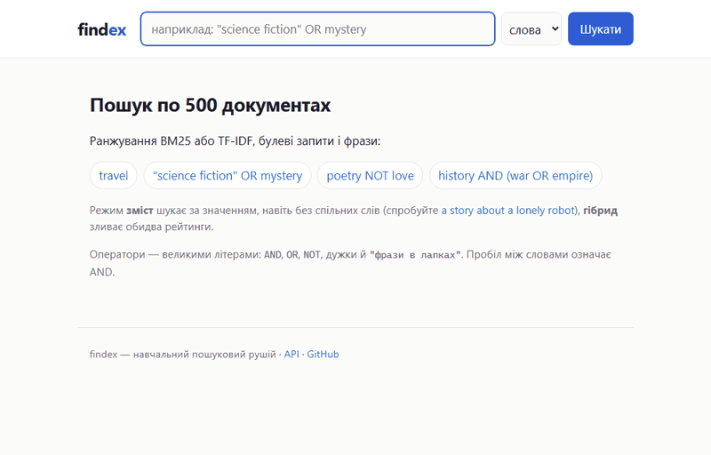
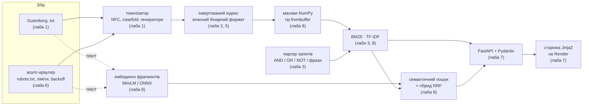

# findex

[](https://github.com/erwrqq2/Python/actions/workflows/ci.yml)

**Пошукова система, написана з нуля на Python: свій краулер, інвертований індекс, BM25,
семантичний пошук і веб-сайт.**

**Спробувати: <https://findex-f2zl.onrender.com>** · API: <https://findex-f2zl.onrender.com/docs> ·
відео (3 хв): VIDEO_URL

> Безкоштовний тариф Render засинає після 15 хв без запитів — перше відкриття триває 30–60 с.



| | |
|---|---|
| **65×** | BM25 на NumPy проти чистого Python — з **тими самими балами до біта** (це тест) |
| **1 727 запитів/с, p95 37 мс** | локальне навантаження `oha`, 4 воркери uvicorn |
| **P@5 0,16 → 0,32** | на перефразованих запитах (без слів із назв книжок) після семантичного пошуку |

Корпуси: 143 книги Project Gutenberg (61 МБ, 10,5 млн токенів, 147 тис. термів) і 500
сторінок [books.toscrape.com](https://books.toscrape.com), які зібрав власний асинхронний
краулер. Проєкт — 8 лабораторних курсу Python; кожна додала одну особливість мови й одну
частину рушія, і в кожної є тег `lab-0N`.

---

## Швидкий старт

Потрібні [uv](https://docs.astral.sh/uv/) і Python 3.13.

```bash
uv sync
uv run findex index corpus/books-toscrape.jsonl --out site.fidx --positions   # 500 сторінок, ~1 с
uv run findex embed site.fidx --corpus corpus/books-toscrape.jsonl            # ембединги, ~40 с
uv run findex search site.fidx '"science fiction" OR mystery' --corpus corpus/books-toscrape.jsonl
uv run findex search site.fidx "a story about a lonely robot" --mode hybrid --corpus corpus/books-toscrape.jsonl
uv run findex serve --index site.fidx --corpus corpus/books-toscrape.jsonl     # http://127.0.0.1:8000
```

Або все в Docker (індекс і модель уже в образі, мережа контейнеру не потрібна):

```bash
docker build -t findex .
docker run --rm -p 8000:8000 findex
```

Великий корпус Gutenberg і власний обхід сайту:

```bash
uv run python scripts/download_gutenberg.py --count 150          # -> data/gutenberg/
uv run findex index data/ --out index.fidx --positions --executor processes
uv run findex crawl https://books.toscrape.com/ --max-pages 500  # -> corpus/*.jsonl
```

Перевірки, як у CI: `uv run pytest`, `uv run ruff check .`, `uv run pyright` (strict, 0 помилок).

## Як дані проходять систему



Типи — pyright strict, пакування — `uv build` (wheel у релізі `v0.4.0`), CLI — typer + rich
(лаба 4); паралельна збірка індексу процесами і порівняння з free-threaded 3.13t (лаба 5).

## Пошук

| Запит | Значення |
|---|---|
| `whale ship`, `whale AND ship` | документи з обома словами |
| `whale OR ship` | з будь-яким із них |
| `whale NOT shark`, `NOT shark` | без `shark` |
| `"white whale"` | фраза — слова поруч і в такому порядку (індекс з `--positions`) |
| `(whale OR ship) NOT shark` | дужки; пріоритет `NOT` > `AND` > `OR`; оператори — великими літерами |

Три режими — в CLI (`--mode`), API (`mode=`) і перемикачем на сторінці:

| Режим | Як рахується | Коли кращий |
|---|---|---|
| `keyword` («слова») | булевий запит вище + BM25 | точні слова, назви, фрази |
| `semantic` («зміст») | косинус ембедингу запиту з фрагментами по 150 слів; бал документа — його найкращий фрагмент | запит своїми словами |
| `hybrid` («гібрид») | Reciprocal Rank Fusion: `Σ 1 / (60 + rank)` по BM25 (значущі слова, OR) і семантиці | коли не знаєш, який з двох |

## Усі вимірювання в одному місці

Машина: Ryzen 5 7500F (6 ядер / 12 потоків), Windows 11, Python 3.13. Методика й сирі
дані — у звіті кожної лаби (посилання в останньому стовпці).

**Пам'ять і формат**

| Що | Результат | |
|---|---|---|
| статистика корпусу: списки → генератори | пік **627 → 26 МіБ** за той самий час (23 с) | [лаба 1](docs/labs/lab-01.md) |
| постинги: `@dataclass` → `slots` → пари `array('I')` | пік збірки 117 → 82 → **57 МіБ** | [лаба 2](docs/labs/lab-02.md) |
| pickle → власний бінарний формат (без позицій) | файл 15,1 → 10,4 МіБ, save **3,07 → 0,44 с** | [лаба 2](docs/labs/lab-02.md) |
| завантаження індексу: об'єкти → `np.frombuffer` | **1,27 → 0,27 с (4,7×)** | [лаба 8](docs/labs/lab-08.md) |

**Швидкість**

| Що | Результат | |
|---|---|---|
| перетин постингів: merge vs `set` | `set` швидший у 1,5–3 рази; merge виграє лише на двох списках по мільйону | [лаба 2](docs/labs/lab-02.md) |
| збірка індексу, 3.13 з GIL: потоки | **1,03×** — GIL не відпускається на токенізації | [лаба 5](docs/labs/lab-05.md) |
| збірка індексу, 3.13: 8 процесів | **7,27 → 2,88 с (2,53×)** | [лаба 5](docs/labs/lab-05.md) |
| збірка індексу, 3.13t без GIL: 8 потоків | **2,57 с (3,08×)** — але однопотоково на 9 % повільніша | [лаба 5](docs/labs/lab-05.md) |
| краулер, 200 сторінок: послідовно → 20 одночасних | **28,1 → 3,0 с (9,4×)**, пік RSS 45 → 49 МіБ | [лаба 6](docs/labs/lab-06.md) |
| CPU-робота в корутині → процес | найдовша пауза event loop **8284 → 113 мс** | [лаба 6](docs/labs/lab-06.md) |
| `/search` під навантаженням, 50 одночасних | 1 воркер 520 RPS, p95 108 мс → 4 воркери **1 727 RPS, p95 37 мс** | [лаба 7](docs/labs/lab-07.md) |
| `/search` на Render free (0,1 CPU), 20 одночасних | 24 RPS, p95 1,1 с | [лаба 7](docs/labs/lab-07.md) |
| `findex search` від запуску до виводу | **2,81 → 1,21 с (2,3×)** після профілювання | [профілювання](docs/profiling/README.md) |
| BM25: Python лаби 3 → NumPy | 0,7× (16 постингів) · 3,3× (143) · 11,4× (1 351) · **65×** (60 тис.) | [лаба 8](docs/labs/lab-08.md) |
| семантичний запит, 86 553 фрагменти | ембединг 1,3 мс + `E @ q` 2,9 мс; гібрид 3,5 мс | [лаба 8](docs/labs/lab-08.md) |

**Якість: precision@5** (15 розмічених запитів на Gutenberg; максимум 0,36, бо в деяких
запитів лише 1–3 релевантні книги)

| Запити | TF-IDF | BM25 | семантика | гібрид |
|---|---|---|---|---|
| 10 запитів лаби 3 | 0,28 | **0,32** | 0,30 | 0,30 |
| 5 перефразованих | — | 0,16 | **0,32** | **0,32** |
| усі 15 | — | 0,27 | **0,32** | **0,32** |

BM25 обходить TF-IDF, бо насичує частоту слова і штрафує довгі документи (лаба 3).
Семантика рятує запити без спільних слів: `angling with artificial lures for river
salmonids` — BM25 0,0, семантика 0,4. На точних словах (`jesus disciples`) BM25 кращий.
Повна таблиця по запитах — у [звіті лаби 8](docs/labs/lab-08.md#4-precision5-10-запитів-лаби-3--5-перефразованих).

**Розгортання**

| Що | Результат |
|---|---|
| образ Docker (два етапи, не root, індекс і модель усередині) | 750 МБ; без моделі було 277 МБ |
| пам'ять контейнера з моделлю, `--memory 512m --network none` | **206 МіБ** — вміщається в Render free |
| тести | 253 (pytest + Hypothesis), покриття 72 %; CI на Ubuntu і Windows, збірка образу, бенчмарки з порогом регресії |

## Баги, які чомусь навчили

- **Апостроф, який був літерою** (лаба 4). Hypothesis знайшов, що U+02BC (MODIFIER LETTER
  APOSTROPHE) Unicode вважає літерою, і токенізатор створював токен з одного апострофа.
  Десять ручних тестів цього не бачили; властивість «повторна токенізація дає ті самі токени»
  побачила й скоротила приклад до одного символу.
- **Пастка `__main__`** (лаба 2). Індекс, збережений через `python -m findex.index`, не
  читався: pickle записав класи як `__main__.Index`. Тепер це регресійний тест.
- **Прихована копія в `casefold()`** (лаба 1). Генератори зменшили пік з 627 до 26 МіБ, але
  `casefold()` цілого документа давав ще 52 МіБ тимчасового буфера (рядок UCS-4). Casefold
  кожного токена прибрав і його.
- **Задачі, які пережили `break`** (лаба 6). Тест «після `break` не лишається задач» знайшов
  витік: `asyncio.wait` не скасовує свої задачі, коли скасовують того, хто чекає. Виправлено
  `finally` в супервізорі й `contextlib.aclosing` у споживачів.
- **Гонка в однопотоковому на вигляд коді** (лаба 7). `def`-маршрути FastAPI виконуються в
  пулі потоків, і два запити перезаписували спільне поле `last_match_count`. GIL не
  захищає інваріантів програми (лаба 5); тепер стану між запитами немає.
- **Гібрид, який слухав стоп-слова** (лаба 8). На «a book about a robot» BM25-частина
  вимагала всі слова разом із «a» і «about», і RRF подвійно винагороджував не ту книжку.
  Тепер BM25 у гібриді бере значущі слова через OR — P@5 гібрида 0,29 → 0,32.

## Обмеження — чесно

- **Корпус малий**: 143 книги і 500 сторінок. Списки постингів короткі, тому NumPy-скоринг
  на Gutenberg дає 2–3×, а не 65×; великі прискорення показані на синтетичних 20 000
  документах.
- **Немає стемінгу і лематизації**: `locomotives` не знайде `locomotive`; кількість
  «релевантних» книг у розмітці — моя оцінка, а 15 запитів — маленька вибірка.
- **Keyword-режим — строгий AND**: один зайвий термін, якого немає в документі, дає 0
  результатів. Тому для запитів своїми словами є семантика і гібрид.
- **Перекіс семантики до довгих документів**: правило «найкращий фрагмент» дає каталогу
  фільмів на 7 тис. фрагментів більше шансів, ніж короткій книзі, — та сама вада, що TF-IDF
  без нормалізації довжини.
- **Ембединги рахуються повільно на CPU**: 56 фрагментів/с, Gutenberg — 26 хв. Тому на
  Render розгорнуто корпус сайту (1 460 фрагментів, рахуються під час збирання образу).
- **Render free**: 0,1 CPU і 512 МБ — 24 RPS проти 1 727 локально, і холодний старт після сну.
- **Усі виміри — на одній машині з Windows.** Scalene там дав ненадійний профіль, тож розподіл
  Python / native зроблено прямим експериментом ([звіт](docs/profiling/README.md)); числа
  на Linux будуть іншими.

## Що де

| | |
|---|---|
| [docs/labs/](docs/labs/) | повні звіти лаб 1–8: рішення, таблиці, «чого я навчився» |
| [docs/profiling/](docs/profiling/README.md) | профілі й flame graphs, гіпотези до змін і результати після |
| [docs/gil.md](docs/gil.md) | GIL і free-threaded Python (лаба 5) |
| [bench/](bench/) | сирі результати вимірювань |
| `src/findex/` | `tokenize`, `corpus`, `index`, `store`, `query`, `rank`, `arrays`, `vector`, `semantic`, `parallel`, `crawler/`, `web/`, `cli` |
| [evaluation/](evaluation/) | розмічені запити для precision@5 |

| Лаба | Тема | Тег |
|---|---|---|
| 1 | [Ітератори, генератори та корпус](docs/labs/lab-01.md) | `lab-01` |
| 2 | [Інвертований індекс: словники, хешування та пам'ять](docs/labs/lab-02.md) | `lab-02` |
| 3 | [Рейтинг і модель об'єктів: dunder-методи, протоколи, декоратори](docs/labs/lab-03.md) | `lab-03` |
| 4 | [Типи, тести, пакування і CLI](docs/labs/lab-04.md) | `lab-04`, `v0.4.0` |
| 5 | [Конкурентність і GIL](docs/labs/lab-05.md) | `lab-05` |
| 6 | [Асинхронний краулер: asyncio](docs/labs/lab-06.md) | `lab-06` |
| 7 | [Пошук у вебі: FastAPI, Pydantic і публічна адреса](docs/labs/lab-07.md) | `lab-07` |
| 8 | [Профілювання, NumPy і семантичний пошук](docs/labs/lab-08.md) | `lab-08`, `v1.0.0` |
