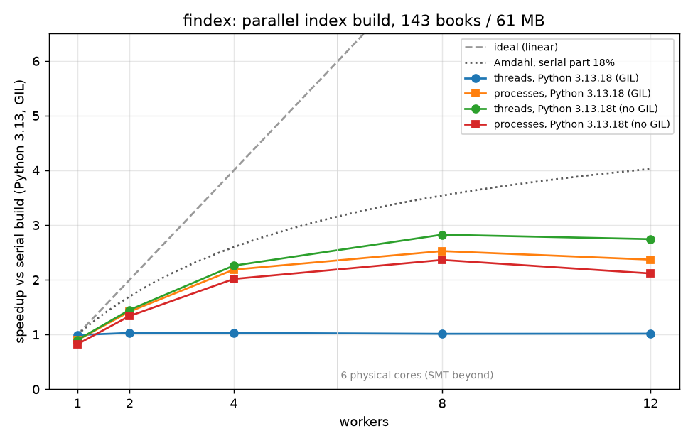

# Лаба 5 — Конкурентність і GIL: потоки, процеси і паралельна індексація

[← до README](../../README.md)

**Пояснення своїми словами — окрема сторінка [docs/gil.md](../gil.md)**: чому
потоки під GIL не прискорили індексацію, чому процеси прискорили і чим це
оплачено, де видно закон Амдала, що змінилось на 3.13t.

### build_partial + merge

`findex/parallel.py` ділить збірку індексу на дві частини:

- `build_partial(chunk, positions)` — функція рівня модуля (її можна віддати
  процесу). У воркер іде `Chunk(first_doc_id, paths)` — **шляхи до файлів**, а не
  прочитані документи: воркер читає їх сам. `doc_id` унікальні на весь корпус,
  бо кожен шматок наперед отримує свій діапазон (`first_doc_id` = позиція його
  першого файлу). Повертає `PartialIndex` з постингами у вигляді плоских
  `array('I')` — кілька великих буферів pickle-ються набагато дешевше, ніж мільйон
  об'єктів `Posting`.
- `merge(partials)` — у батьківському процесі. Шматки — суцільні діапазони
  `doc_id`, тож склеювання постингів кожного терму в порядку шматків лишає їх
  відсортованими без жодного `sort()`.
- Шматки нарізаються за **розміром у байтах**, а не за кількістю файлів (у корпусі
  є книга на 4.3 МБ — вона не повинна потрапити в шматок разом із тридцятьма
  іншими); шматків у 4 рази більше, ніж воркерів, щоб повільний шматок не
  простоював решту.
- Послідовний варіант — рівно `merge([build_partial(усі шляхи)])`; тест
  перевіряє, що він дає той самий індекс, що `build_index` з лаби 4. Окремі тести:
  будь-яке розбиття на шматки (і Hypothesis-властивість на випадкових корпусах)
  дає той самий індекс; файли індексу з `serial`, `threads` і `processes`
  **побайтно однакові**.

```bash
findex index data/ --out index.fidx --executor processes --workers 8   # типово: processes, усі ядра
findex index data/ --out index.fidx --executor threads --workers 4
findex index data/ --out index.fidx --executor serial
```

- `processes` — `ProcessPoolExecutor` з методом **`spawn`** (новий інтерпретатор на
  воркер; однаково на Windows, macOS і Linux). Безпечно для spawn: кожен воркер
  заново імпортує головний модуль, тому `findex/__main__.py` запускає CLI лише під
  `if __name__ == "__main__"`.
- Якщо воркер падає, збірка падає з **його стеком** (`concurrent.futures` додає
  трасування воркера як `__cause__`), решта шматків скасовується
  (`shutdown(cancel_futures=True)`) — нічого не зависає. Тест видаляє файл
  після нарізки й перевіряє, що `FileNotFoundError` з `build_partial` у трасуванні
  доходить до батьківського процесу.
- Воркерів не більше, ніж шматків: на маленькому корпусі не запускаються зайві
  процеси.

### Методика вимірювань

- **Машина**: AMD Ryzen 5 7500F, 6 фізичних ядер / 12 логічних
  (`os.cpu_count()` = 12), 32 ГБ RAM, Windows 11, настільний ПК (без батареї),
  під час вимірів фонові програми не навантажували процесор.
- **Корпус**: 143 книги, 61 МБ; індекс без позицій.
- **Python**: 3.13.18 (зі звичайним GIL) і 3.13.18 free-threaded (`3.13t`,
  `sys._is_gil_enabled() == False` — записано в кожному рядку результатів).
- `uv run python -m findex.bench_parallel sweep data/ --runs 3` — **кожен замір в
  окремому свіжому процесі** (пік RSS — це максимум за все життя процесу); один
  прогрівальний прогін (корпус потрапляє в кеш ОС); конфігурації чергуються
  прогін за прогоном, щоб дрейф температури й частоти розподілився на всі.
  3 прогони на клітинку, у таблиці — **медіана** і діапазон min–max.
- **Wall** — `time.perf_counter()` навколо всієї збірки (map + merge), без
  збереження файлу. **CPU** — CPU батьківського процесу (усіх його потоків) +
  CPU процесів-воркерів, прочитаний через `psutil`, поки вони ще живі (разом з
  їхнім запуском і pickle). **Peak RSS** — пік робочого набору батьківського
  процесу (Windows `peak_wset`); окремою колонкою — сума піків воркерів.
  **Speedup** — serial wall / wall на тому самому інтерпретаторі; остання колонка
  — відносно serial зі звичайним GIL.

### Результати

| Python | Executor | Workers | Wall, s (median) | min–max | CPU, s | Peak RSS parent | Workers' RSS (sum) | Merge, s | Speedup | vs GIL serial |
|---|---|---|---|---|---|---|---|---|---|---|
| 3.13.18 | serial | 1 | **7.27** | 7.22–7.50 | 7.1 | 139 MiB | — | 0.40 | **1.00×** | 1.00× |
| 3.13.18 | threads | 1 | **7.34** | 7.31–7.42 | 7.1 | 159 MiB | — | 0.51 | **0.99×** | 0.99× |
| 3.13.18 | threads | 2 | **7.06** | 6.99–7.11 | 7.0 | 171 MiB | — | 0.59 | **1.03×** | 1.03× |
| 3.13.18 | threads | 4 | **7.06** | 7.02–7.07 | 7.0 | 194 MiB | — | 0.67 | **1.03×** | 1.03× |
| 3.13.18 | threads | 8 | **7.17** | 7.13–7.27 | 7.2 | 212 MiB | — | 0.74 | **1.01×** | 1.01× |
| 3.13.18 | threads | 12 | **7.15** | 7.14–7.27 | 7.2 | 228 MiB | — | 0.78 | **1.02×** | 1.02× |
| 3.13.18 | processes | 1 | **8.09** | 8.04–8.15 | 8.0 | 169 MiB | 82 MiB | 0.53 | **0.90×** | 0.90× |
| 3.13.18 | processes | 2 | **5.12** | 5.01–5.45 | 8.8 | 179 MiB | 103 MiB | 0.65 | **1.42×** | 1.42× |
| 3.13.18 | processes | 4 | **3.32** | 3.29–3.76 | 10.7 | 203 MiB | 178 MiB | 0.67 | **2.19×** | 2.19× |
| 3.13.18 | processes | 8 | **2.88** | 2.84–2.92 | 15.2 | 226 MiB | 296 MiB | 0.79 | **2.53×** | 2.53× |
| 3.13.18 | processes | 12 | **3.07** | 3.00–3.07 | 18.5 | 244 MiB | 410 MiB | 0.81 | **2.37×** | 2.37× |
| 3.13.18t | serial | 1 | **7.91** | 7.85–8.12 | 7.6 | 146 MiB | — | 0.45 | **1.00×** | 0.92× |
| 3.13.18t | threads | 1 | **8.06** | 8.00–8.49 | 7.9 | 170 MiB | — | 0.53 | **0.98×** | 0.90× |
| 3.13.18t | threads | 2 | **5.01** | 5.00–5.09 | 8.6 | 183 MiB | — | 0.60 | **1.58×** | 1.45× |
| 3.13.18t | threads | 4 | **3.21** | 3.11–3.28 | 9.6 | 209 MiB | — | 0.71 | **2.46×** | 2.26× |
| 3.13.18t | threads | 8 | **2.57** | 2.55–2.65 | 12.4 | 238 MiB | — | 0.82 | **3.08×** | 2.83× |
| 3.13.18t | threads | 12 | **2.65** | 2.64–2.67 | 14.1 | 277 MiB | — | 0.89 | **2.99×** | 2.74× |
| 3.13.18t | processes | 1 | **8.82** | 8.81–8.83 | 8.6 | 180 MiB | 106 MiB | 0.55 | **0.90×** | 0.82× |
| 3.13.18t | processes | 2 | **5.43** | 5.38–5.52 | 9.5 | 192 MiB | 127 MiB | 0.60 | **1.46×** | 1.34× |
| 3.13.18t | processes | 4 | **3.60** | 3.59–3.63 | 11.7 | 216 MiB | 205 MiB | 0.69 | **2.20×** | 2.02× |
| 3.13.18t | processes | 8 | **3.07** | 3.06–3.15 | 16.3 | 242 MiB | 343 MiB | 0.79 | **2.57×** | 2.36× |
| 3.13.18t | processes | 12 | **3.43** | 3.40–3.45 | 20.6 | 262 MiB | 493 MiB | 0.88 | **2.30×** | 2.12× |



- **threads під GIL — 1.0× за будь-якої кількості воркерів**: CPU time = wall time,
  у кожен момент байт-код виконує один потік.
- **processes — 2.53× на 8 воркерах** (2.88 с замість 7.27 с), але CPU time
  подвоюється (7.1 → 15.2 с), а пам'ять — батько 226 МіБ + воркери 296 МіБ.
- **12 воркерів повільніші за 8**: фізичних ядер 6, далі — SMT (два потоки на
  ядро); окремий дослід: чистий цикл Python займає 0.42 с поодинці і 0.68 с, коли
  їх 12 одночасно.
- **Амдал**: на 8 процесах merge (0.79 с) + запуск пулу (0.55 с) — майже половина
  wall time. Відносно послідовної збірки це ~18% послідовної роботи → стеля ~5.4×
  навіть на нескінченній кількості ядер (пунктирна крива на графіку).
- **3.13t: потоки — 2.83×, найкращий результат** — без запуску процесів і без
  pickle; але один потік на 9% повільніший (7.91 проти 7.27 с).

**Типовий `--executor` — `processes`**: на звичайному CPython (з GIL) він виграє
(2.53× проти 1.0× у потоків).

### Гонки на 3.13t

У самій індексації спільного змінного стану немає (кожен `build_partial` пише у
свої словники), тож і гонки немає: на 3.13t індекс із 12 потоків побайтно
збігається з послідовним (перевірено окремо, у трьох прогонах; тести в CI
запускаються на звичайному 3.13). Що було б зі спільним станом,
показує `scripts/race_demo.py` (8 потоків × 200 000 оновлень, очікується
1 600 000):

| варіант | 3.13 (GIL) | 3.13t (без GIL) |
|---|---|---|
| `counter += 1` (глобальний int) | 1 600 000 | **251 297** (−84%) |
| `counts[w] += 1` (спільний Counter) | 1 600 000 | **1 093 037** (−32%) |
| те саме під `threading.Lock` | 1 600 000, 0.20 с | 1 600 000, 2.38 с |
| свій Counter у кожному потоці + merge | 1 600 000, 0.22 с | 1 600 000, 0.16 с |
| `shared.append(x)` | 1 600 000 | 1 600 000 |

Причина й фікс — у [docs/gil.md](../gil.md#що-змінилось-на-313t-без-gil): `+=` —
це load / add / store, між якими інший потік встигає записати своє; `Lock`
лагодить, але в 15 разів повільніше, ніж просто не ділити стан.

### Як відтворити

```bash
uv sync
uv run python -m findex.bench_parallel sweep data/ --runs 3 --out bench/results.json

# free-threaded 3.13t (typer тягне pydantic-core, для якого немає колеса під 3.13t
# на Windows, тому findex ставиться без залежностей — модулю parallel вони не потрібні)
uv python install 3.13t
uv venv .venv-ft --python 3.13t
uv pip install --python .venv-ft/Scripts/python.exe --no-deps -e .
uv pip install --python .venv-ft/Scripts/python.exe psutil
.venv-ft/Scripts/python.exe -c "import sys; print(sys._is_gil_enabled())"   # False
uv run python -m findex.bench_parallel sweep data/ --runs 3 --out bench/results.json \
    --python .venv-ft/Scripts/python.exe

uv run python -m findex.bench_parallel report bench/results.json --plot docs/speedup.png --amdahl 0.18
.venv-ft/Scripts/python.exe scripts/race_demo.py
```

Сирі результати всіх 66 прогонів — `bench/results.json`, таблиця — `bench/table.md`.

### Чого я навчився

- Конкурентність ≠ паралелізм: потоки під GIL чергуються, а не працюють
  одночасно; для роботи, обмеженої процесором, потрібні окремі інтерпретатори
  (процеси) або інтерпретатор без GIL.
- Паралелізм не безкоштовний: прискорення 2.5× коштувало вдвічі більше CPU time і
  втричі більше пам'яті.
- Послідовна частина (merge, запуск пулу) визначає стелю — оптимізувати треба
  передусім її.
- Найпростіший спосіб уникнути гонок — не ділити змінний стан: кожен воркер
  рахує своє, злиття одне.
